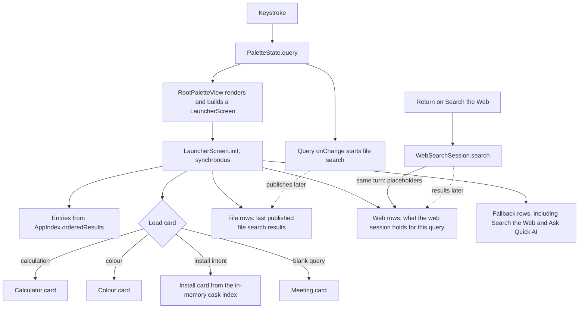
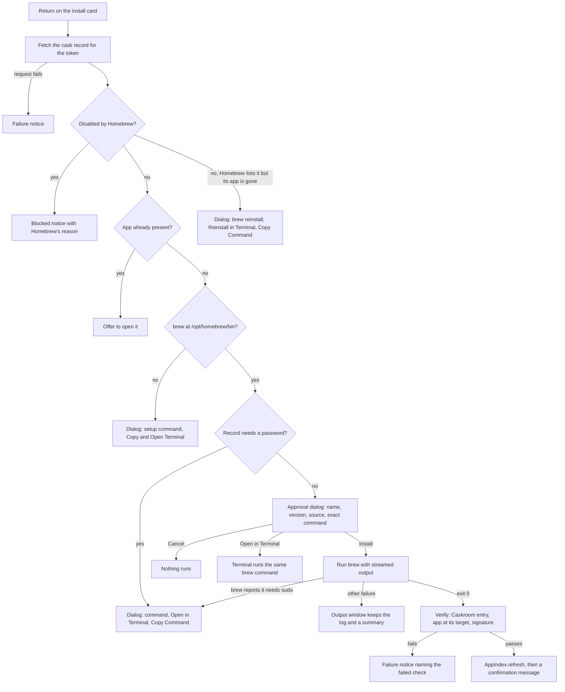

# Proposed architecture

How the fork adds app install, web results and AI routing to Tinycast without restructuring it.

- **Strategy:** build on the fork, add beside the existing model, keep merging upstream.
- **Basis:** `ARCHITECTURE_AUDIT.md`, with every claim this design leans on re-read in source at commit
  `d9414598` on 2026-11-12. Outside facts (Homebrew, search providers) were read from primary pages
  the same day.
- **Not verified:** nothing was built or run. Section 9 lists each assumption that needs a run.
- **Related documents:** scope is in `MVP_SCOPE.md`, phases and estimates in
  `IMPLEMENTATION_ROADMAP.md`, threats, open decisions, upstream sync and licence duties in
  `RISKS_AND_DECISIONS.md`.

`<AppName>`, `<bundle-id>` and `<scheme>` stand for choices that are still open (decision D1 in
`RISKS_AND_DECISIONS.md`).

## 1. Ground rules

1. **Extend the existing vocabularies; add no parallel system.** A new behaviour is one new case in a
   closed enum upstream already has, plus new files in a new feature folder. No seam function is
   restructured.
2. **A row's slot is decided synchronously.** Whether a card or section is present depends only on the
   query text, a switch, or something the user did earlier. It never depends on a network reply that
   has not arrived. Late data fills a slot that already exists (section 3.2).
3. **No network on a keystroke.** Typing only reads memory. A request is sent when the user presses
   Return on something, or on a daily timer.
4. **Fork preferences stay out of upstream's registries.** Each feature keeps its switches in its own
   store under raw `UserDefaults` keys (decision D6).
5. **Upstream's rules still apply to new code:**
   - `AppCore` owns every long-lived object and wires it in `start()`.
   - A file under `Features/*/Model/` imports Foundation only and takes clock, paths and network as
     parameters.
   - Types are marked `@MainActor` explicitly. The project sets no default isolation, so an
     unannotated type is nonisolated.
   - No new actor. Work that must leave the main actor uses a `@concurrent` function or a detached
     task.
   - A result that arrives after a suspension is checked against the current request before it is
     applied. Cancellation is never reported as an ordinary failure.
   - Network code uses a private `.ephemeral` session with `urlCache = nil`.
   - Dialogs go through `AppCore.confirm` and `AppCore.choose`, never `NSAlert`.

## 2. What is added

| Addition | New folder | Existing vocabulary extended | Phase |
| --- | --- | --- | --- |
| App install from the main list | `Tinycast/Features/PackageInstall/` | `LauncherScreen.Row`, `LauncherList.LeadCard` | 1 |
| Web result rows | `Tinycast/Features/WebSearch/` | `LauncherScreen.Row`, `LauncherList` sections, `Fallback.Builtin`, `CommandID` | 2 |
| Settings for both | Each feature's own `Settings/` folder | None: one line in an existing pane's view | 1 and 2 |
| AI | None | None | None |

Three vocabularies are deliberately left alone in the first two phases:

- **`AppEntry.Kind`.** An entry is something `AppIndex` holds and ranks. Install candidates and web
  results are answers to one query, like a calculator result, so they are rows, not entries.
- **`PaletteMode`.** Neither feature needs its own screen. Approval is a dialog and progress is the
  existing output window.
- **`HotKeyAction`.** Nothing new needs a global shortcut.

## 3. Query flow



### 3.1 How an asynchronous source feeds the synchronous row builder

File search is the precedent, and both new sources copy it:

1. A `@MainActor @Observable` session object holds the latest published state
   (`FileSearchSession.results`).
2. `LauncherScreen.init` calls a coordinator function that reads that state for the current query
   (`FileSearchCoordinator.launcherFiles(for:)`).
3. Because the read happens while `RootPaletteView.body` is evaluated, Observation tracks it. When
   the session publishes, the body re-renders and `init` runs again. No `onChange` is involved.
4. A result is applied only if it still matches the current request
   (`guard revision == next.revision, request == next.request` in `FileSearchSession.runWorker`).

The new coordinators expose the same shape: `PackageInstallCoordinator.candidate(for:)` and
`WebSearchCoordinator.launcherRows(for:)`, both synchronous and both pure reads.

### 3.2 Late results and the selection

`PaletteState.selection` is a plain row index. Nothing preserves the selected row when rows change, so
a section that appears above the selection changes what Return activates. Upstream's file rows already
have this weakness for a selected fallback row. The new rows avoid adding to it with four rules:

| Rule | Install card | Web rows |
| --- | --- | --- |
| The slot is present for a synchronous reason | Present whenever the query is an install request and the feature is on, whatever the index state | Present once the user has pressed Return on Search the Web for this query in this session |
| A placeholder holds the slot | The card shows "Loading…" or "No match" in the same slot, with no action | Five placeholder rows appear in the same main-actor turn as the trigger |
| Late data replaces the placeholder in place | The card's text changes; no row moves | Five placeholders become up to five results |
| The user's own action moves the selection | A query change already lands the selection on row 0, which is the card | The trigger sets the selection to the first web row and scrolls it into view |

How the trigger moves the selection: `LauncherScreen` sets `vm.selection` to
`rows.count - fallbacks.count - web.count`, the index where the web section starts, and calls its
`scrollToFollow` closure. That expression is right both on a first search, when the section does not
exist yet, and on Search Again, when it does. The fallback's Cmd-K menu calls the coordinator
directly today, so it is given a closure from the screen to do the same.

Results fetched earlier in the session are kept in memory. Typing a query that was already searched
shows its rows again at once, in the same render as the other rows, so nothing arrives late.

Two limits remain:

- If a search returns fewer than five results, the fallback rows below the web section move up by the
  difference. Only fallback rows are below it.
- File results can still arrive after a web search was triggered and push the web section down. In
  practice file results arrive within milliseconds and a web search needs a deliberate Return.

### 3.3 Latency

| Source | Runs | Network |
| --- | --- | --- |
| Entries, calculator, colour | Every render, memoized (existing) | None |
| Install card | Every render for an install-intent query; a one-deep memo keyed by query and index revision | None |
| Cask index refresh | Once a day, 30 minutes after a failure | One 64 KB download |
| Cask record | On Return on the install card | One small request |
| File rows | Query change (existing) | None |
| Web rows | On Return on Search the Web | One request, 10 s timeout |
| AI | On Tab or Return on Ask Quick AI (existing) | Depends on the route |

## 4. Package install

Scope for the first version: Homebrew casks only, on Apple silicon, with Homebrew at
`/opt/homebrew`. Formulae and installs without Homebrew are later work.

### 4.1 Components

| Type | Layer | Isolation | Responsibility | Existing types it uses |
| --- | --- | --- | --- | --- |
| `InstallIntent` | Model | pure | Recognise "install NAME" and return the name | None |
| `CaskIndex` | Model | `Sendable` value | Tokens with 30-day install counts; fuzzy match and ordering | `LauncherMatch` |
| `CaskRecord` | Model | `Sendable` value | The decoded part of one cask record | None |
| `InstallPlan` | Model | pure | Decide what approval should offer, from a record and facts about the Mac | None |
| `InstallVerification` | Model | pure | Decide whether an install succeeded, from observed facts | None |
| `InstalledCask` | Model | `Sendable` value | One Caskroom entry and the app paths its install receipt records | None |
| `InstallApproval` | Model | pure | The approval dialog's message, every line from the record | None |
| `CaskIndexStore` | Service | `@MainActor @Observable` | Download, cache and refresh the index | `AppPaths` |
| `CaskAPI` | Service | `@concurrent` statics | Fetch one cask record | None |
| `HomebrewEnvironment` | Service | nonisolated and `@concurrent` statics | Find `brew`; read the Caskroom | None |
| `CaskInstaller` | Service | nonisolated statics | Start the install | `ShellCommandRunner`, `ShellCommandSession` |
| `InstallVerifier` | Service | `@concurrent` statics | Gather the facts verification needs | `BundleSignature` |
| `TerminalHandoff` | Service | `@MainActor` | Run one `brew` command in Terminal; open Terminal | `AppLauncher`, `NSWorkspace` |
| `PackageInstallSettingsStore` | Settings | `@MainActor @Observable` | The feature switch, under a raw key | None |
| `PackageInstallCoordinator` | UI | `@MainActor` | The feature's action surface; owns the flow and its output window | `AppCore`, `AppIndex`, `CommandOutputPresenter`, `PaletteCoordinator` |
| `PackageInstallCard`, `PackageActionsMenu` | UI | views | The lead card and its Cmd-K menu | `PopoverMenuContent`, `Theme` |
| `PackageInstallSettingsSection` | Settings | view | One section, shown in the Applications pane | `AppCore` from the environment |

### 4.2 Interfaces

Sketches, not final code. Names follow upstream's suffix table. The Model sketches were revised on
2026-11-13 against the code written in Phase 1 step 1 and Homebrew's real replies; `CaskToken`
(the token pattern) was added there too.

```swift
// Model/InstallIntent.swift
enum InstallIntent {
    /// One letter matches hundreds of casks, so a shorter name shows no card at all.
    static let minimumLetters = 2
    /// "install blender" gives "blender"; nil unless the query is an install request.
    static func name(in query: String) -> String?
}

// Model/CaskIndex.swift
struct CaskIndex: Sendable, Equatable {
    struct Entry: Sendable, Equatable {
        let token: String
        let installs: Int
    }
    let entries: [Entry]
    let generatedAt: Date

    static func decode(analytics data: Data, now: Date) throws -> CaskIndex
    func contains(token: String) -> Bool
    /// Exact token first, then whole words by install count, then partial hits by score.
    /// `extra` adds tokens the file lacks (installed casks, from the Caskroom snapshot).
    func matches(_ name: String, limit: Int, including extra: [Entry] = []) -> [Entry]
}

// Model/CaskRecord.swift
struct CaskRecord: Sendable, Equatable {
    struct AppArtifact: Sendable, Equatable {
        let source: String
        /// Resolved by Homebrew, such as `/Applications/Blender.app`.
        let target: String
        /// The target's last component: `Thorium.app` installs as `Thorium Browser.app`.
        var installedName: String { get }
    }
    struct Retirement: Sendable, Equatable {
        /// Homebrew's symbols (`fails_gatekeeper_check`, `discontinued`, ...) as cases,
        /// or `.stated(String)` for a cask's own sentence. Never shown raw.
        enum Reason: Sendable, Equatable { /* … */ }
        let reason: Reason?
        let date: String?
        let replacementCask: String?
    }
    let token: String
    let names: [String]
    let summary: String?
    let homepage: URL?
    let downloadURL: URL?
    let version: String
    let apps: [AppArtifact]
    /// A pkg; a `sudo` of `true` or `"if_needed"` in an install-time step (not uninstall or
    /// zap); or a target under `/Library`, `/usr` or `/System`.
    let needsPassword: Bool
    /// An `installer manual:` step: Homebrew only stages an installer the user must open.
    let hasManualInstaller: Bool
    let disabled: Retirement?
    let deprecated: Retirement?

    /// `variation` is this Mac's key in the record's `variations`, from
    /// `variation(macOSMajorVersion:)`: `arm64_tahoe` on 26, `arm64_golden_gate` on 27.
    /// The base record describes the newest release; the entry overlays its top-level fields.
    static func variation(macOSMajorVersion: Int) -> String?
    static func decode(_ data: Data, variation: String?) throws -> CaskRecord
}

// Model/BrewInvocation.swift
struct BrewInvocation: Sendable, Equatable {
    enum Verb: String, Sendable { case install, reinstall }
    /// The fixed script in section 4.3, now `exec "$1" "$2" --cask "$3"`: brew, verb, token.
    static let script: String
    let brew: URL
    let token: String
    let verb: Verb
    /// Nil unless `token` passes `CaskToken.isValid`.
    init?(brew: URL, token: String, verb: Verb = .install)
    /// What the dialog shows, `brew install --cask TOKEN`; it is exactly what runs.
    var displayText: String { get }
    var arguments: [String] { get }
    /// The `.command` file `TerminalHandoff` writes (section 4.7).
    var terminalScript: String { get }
    /// Homebrew's "sudo is disabled by HOMEBREW_NO_SUDO." anywhere in a run's output.
    static func refusedSudo(in output: String) -> Bool
}

// Model/InstalledCask.swift
struct InstalledCask: Sendable, Equatable {
    let token: String
    let appPaths: [String]
    /// Filled by `HomebrewEnvironment`, which checked each path on disk.
    let missingAppPaths: [String]
    var missingAppName: String? { get }
    /// From `INSTALL_RECEIPT.json`'s `uninstall_artifacts` and `config.json`'s `appdir`.
    static func appPaths(receipt: Data, config: Data?, home: String) -> [String]
}

// Model/InstallApproval.swift
enum InstallApproval {
    static func message(record: CaskRecord, invocation: BrewInvocation) -> String
}

// Model/InstallPlan.swift
enum InstallPlan: Sendable, Equatable {
    struct Facts: Sendable, Equatable {
        let brew: URL?
        /// The Caskroom by token, with any app its receipt records but the disk lacks.
        let installedCasks: [String: InstalledCask]
        let presentAppNames: Set<String>
    }
    static let homebrewSetupCommand: String

    case install(BrewInvocation)
    /// A password or a manual installer step.
    case terminal(BrewInvocation)
    case homebrewMissing
    /// Homebrew lists the cask but its app was deleted: `brew reinstall`, offered in Terminal.
    case reinstall(BrewInvocation, missingApp: String)
    /// Nil `appName` for a pkg.
    case alreadyInstalled(appName: String?, byHomebrew: Bool)
    /// Typed, so the dialog localizes the reason rather than showing Homebrew's symbol.
    case disabled(CaskRecord.Retirement)
    /// A record whose token fails `CaskToken.isValid`; the decoder already refuses one.
    case invalidToken

    static func make(record: CaskRecord, facts: Facts) -> InstallPlan
}

// Model/InstallVerification.swift
enum InstallVerification: Sendable, Equatable {
    struct Observation: Sendable, Equatable {
        let hasCaskroomEntry: Bool
        let missingApps: [String]
        /// Sealed by neither Apple nor a Developer ID.
        let untrustedApps: [String]
    }
    case verified
    case noCaskroomEntry
    case appMissing(String)
    case appUntrusted(String)

    static func judge(_ observation: Observation) -> InstallVerification
}

// Model/PackageCandidate.swift
struct PackageCandidate: Sendable, Equatable {
    enum State: Sendable, Equatable {
        case loadingIndex
        /// No index in memory or on disk and no fetch running: offline on a first launch.
        case indexUnavailable
        case noMatch
        case match(CaskIndex.Entry, alternates: [CaskIndex.Entry])
    }
    /// What the Caskroom snapshot says about the match, shown on the card itself.
    enum Installation: Sendable, Equatable { case installed, appMissing(String) }
    static let alternateLimit = 4
    let requestedName: String
    let state: State
    let installation: Installation?
    /// An index in hand is used even while a refresh runs.
    init(requestedName: String, index: CaskIndex?, isFetchingIndex: Bool,
         installed: [String: InstalledCask])
    var hasAction: Bool { get }
}
```

```swift
// Service/CaskIndexStore.swift
@MainActor @Observable
final class CaskIndexStore {
    struct Schedule: Sendable {
        let refresh: TimeInterval   // 24 h from the index's fetchedAt
        let retry: TimeInterval     // 30 min after a failed fetch
        static let standard: Schedule
    }
    /// Kept through a refresh, so the card never drops back to "Loading…".
    private(set) var index: CaskIndex?
    /// The cache read or a fetch is running; with no index this means loading, not unavailable.
    private(set) var isFetching: Bool
    private(set) var revision: Int

    /// `baseURL`, `protocolClasses`, `schedule` and `now` exist so a harness can serve
    /// fixtures in process and run the schedule in fractions of a second.
    init(cacheURL: URL, baseURL: URL = homebrewAPI, protocolClasses: [AnyClass]? = nil,
         schedule: Schedule = .standard, now: @escaping () -> Date = Date.init)
    /// Reads the cache off the main actor, then refreshes on the schedule.
    func start()
    /// Cancels the pump; a reply that arrives later is never applied or cached.
    func stop()
}

// Service/CaskAPI.swift
enum CaskAPI {
    /// `notFound` is a 404 (or a token that fails `CaskToken.isValid`, never requested);
    /// `malformed` includes a record whose token differs from the one asked for.
    enum Failure: Error, Equatable { case notFound, unavailable, malformed }
    nonisolated static let base: URL   // https://formulae.brew.sh/api/, shared with the store
    /// The one ephemeral, cacheless session shape; `CaskIndexStore` builds its own from it.
    nonisolated static func session(protocolClasses: [AnyClass]? = nil) -> URLSession
    /// Throws `Failure`, or `CancellationError` when the caller is cancelled.
    @concurrent nonisolated static func record(token: String, variation: String?,
        baseURL: URL = base, session: URLSession) async throws -> CaskRecord
}

// Service/HomebrewEnvironment.swift
enum HomebrewEnvironment {
    nonisolated static let prefix = URL(fileURLWithPath: "/opt/homebrew")
    nonisolated static func brew(prefix: URL = prefix) -> URL?
    /// Tokens whose Caskroom folder has `.metadata`, which Homebrew writes once an install completes.
    @concurrent nonisolated static func installedCasks(prefix: URL = prefix) async -> Set<String>
}

// Service/CaskInstaller.swift
enum CaskInstaller {
    nonisolated static func install(_ invocation: BrewInvocation) -> ShellCommandSession
}

// Service/InstallVerifier.swift
enum InstallVerifier {
    /// `prefix` and `home` are parameters so a harness can lay out a scratch Caskroom.
    @concurrent nonisolated static func observe(record: CaskRecord,
        prefix: URL = HomebrewEnvironment.prefix, home: String = NSHomeDirectory())
        async -> InstallVerification.Observation
}

// Service/TerminalHandoff.swift
enum TerminalHandoff {
    /// Writes `BrewInvocation.terminalScript` to a `.command` file and opens it with
    /// Terminal.app by path, not the user's default handler for `.command`.
    @MainActor static func run(_ invocation: BrewInvocation) async throws
    /// Brings Terminal forward and runs nothing.
    @MainActor static func openTerminal()
}

// Settings/PackageInstallSettingsStore.swift
@MainActor @Observable
final class PackageInstallSettingsStore {
    /// Raw key `packageInstallEnabled`; on by default.
    var isEnabled: Bool
    init(defaults: UserDefaults = .standard)
}

// UI/PackageInstallCoordinator.swift
@MainActor @Observable
final class PackageInstallCoordinator {
    let settings: PackageInstallSettingsStore
    /// The Caskroom snapshot; observed, so the card updates when it changes.
    private(set) var installed: [String: InstalledCask]
    func applyEnabled()
    /// The settings section's switch writes through this, so turning it on starts the store.
    func setEnabled(_ enabled: Bool)
    /// Called from `PaletteCoordinator.onLauncherShown`: one Caskroom read per show, ~16 ms.
    func refreshInstalled()
    /// Read by `LauncherScreen.init`; touches memory only. One-deep memo keyed by the name,
    /// the index revision, whether a fetch runs, and the snapshot.
    func candidate(for query: String) -> PackageCandidate?
    func activate(_ candidate: PackageCandidate)
    /// The flow, for the card's cask or an alternate from the ⌘K menu.
    func install(token: String)
    func copyInstallCommand(token: String)
    func openHomebrewPage(token: String)
}
```

### 4.3 Homebrew data and commands

**Lookup uses Homebrew's public JSON, not `brew`.** Everything read-only comes from two endpoints and
one folder, so matching never waits on a subprocess.

| Need | Source | Notes |
| --- | --- | --- |
| Names to match against | `https://formulae.brew.sh/api/analytics/cask-install/homebrew-cask/30d.json` | 6,082 cask tokens with 30-day install counts; 64 KB gzipped, 332 KB raw. Counts are strings and the map key is `formulae`. |
| Details of one cask | `https://formulae.brew.sh/api/cask/TOKEN.json` | Token, names, description, homepage, URL, version, checksum, artifacts, disabled and deprecated flags |
| What is installed | `/opt/homebrew/Caskroom/TOKEN/.metadata/VERSION/TIMESTAMP/Casks/` | Homebrew's own record of an installed cask; gives token and version without running `brew` |

Why the small analytics file and not the full catalogue: `cask.json` is 19.4 MB uncompressed for
7,827 casks. Decoding it in the app risks breaking upstream's 100 MB memory rule for a few seconds,
and most of it is never used. The analytics file gives tokens plus a popularity order for free. The
cost is that matching sees tokens (`visual-studio-code`), not display names (decision D4).

**The install command.** `CaskInstaller` calls `ShellCommandRunner.stream` with a fixed script and two
positional values, so no user or network text is ever parsed by the shell:

```sh
HOMEBREW_NO_SUDO=1 HOMEBREW_NO_ASK=1 HOMEBREW_CASK_OPTS= HOMEBREW_NO_ANALYTICS=1 \
HOMEBREW_NO_ENV_HINTS=1 HOMEBREW_NO_INSTALL_CLEANUP=1 \
  exec "$1" install --cask "$2"
```

`$1` is `/opt/homebrew/bin/brew` and `$2` is the token, checked against `^[a-z0-9][a-z0-9@+._-]*$`.

| Setting | Why |
| --- | --- |
| `HOMEBREW_NO_SUDO=1` | `brew` never prompts for a password. When a step first needs `sudo`, Homebrew fails it with "sudo is disabled by HOMEBREW_NO_SUDO." (`system_command.rb`, Homebrew 7.0.13). For a pkg that is after the download, when `installer` runs, not before it. `CaskRecord.needsPassword` sends such casks to Terminal beforehand, so this message is the fallback, detected by `BrewInvocation.refusedSudo(in:)`. |
| `HOMEBREW_NO_ASK=1` | Homebrew 7 asks for confirmation by default and skips asking only "without a TTY" (`cmd/install.rb`). The runner's pseudo-terminal is a TTY whose input nobody writes, so a question would wait forever. |
| `HOMEBREW_CASK_OPTS=` (empty) | The runner always starts a login shell, so the user's `~/.zprofile` runs first. A custom install folder set there would make the dialog's "Installs to" line wrong. |
| `HOMEBREW_NO_ANALYTICS=1` | Installs started by the launcher are not reported to Homebrew's analytics. |
| `HOMEBREW_NO_ENV_HINTS=1`, `HOMEBREW_NO_INSTALL_CLEANUP=1` | Shorter output, no unrelated cleanup |
| Auto-update left on | A stale local copy of the catalogue can point at a download that no longer exists. |

`ShellCommandRunner.stream` takes no environment parameter, which is why the settings sit in the
script text.

**Commands shown to the user and never run by the app:**

- Homebrew setup, exactly as brew.sh prints it:
  `/bin/bash -c "$(curl -fsSL https://raw.githubusercontent.com/Homebrew/install/HEAD/install.sh)"`
- A cask that needs a password: `brew install --cask TOKEN`, run in Terminal.

### 4.4 Matching a cask to an installed app

Cask records carry no bundle identifier, so presence is decided from two facts:

1. **Homebrew's record.** The token has a folder under the Caskroom. The cask is installed by
   Homebrew.
2. **The app artifact's installed name.** The record's `app` artifact carries the target Homebrew
   resolved, such as `/Applications/Blender.app`; its last component is the installed name, which
   can differ from the source (`Thorium.app` installs as `Thorium Browser.app`). If `AppIndex.apps`
   holds an application entry whose `url.lastPathComponent` equals it, the app is present. If fact 1
   is false, it was installed some other way.

A pkg cask has no `app` artifact, so only fact 1 applies to it. When the app is present outside
Homebrew, the flow offers to open it and does not install.

A third fact comes from the Caskroom itself. Homebrew's local `Casks/TOKEN.json` copy is empty for
casks loaded from the API, but `.metadata/INSTALL_RECEIPT.json` lists the `app` artifacts it
installed (with any renaming target), and `.metadata/config.json` says which `appdir` it used.
`HomebrewEnvironment.installedCasks` reads both for every cask on each launcher show (about 16 ms on
the owner's Mac) and checks each recorded app on disk. When the Caskroom records a cask whose app is
gone, the card says so ("Prowlarr.app is missing · Reinstall"), and Return offers
`brew reinstall --cask TOKEN` through the Terminal hand-off rather than "already installed". If the
launcher still finds an app of that name somewhere else, the cask counts as installed.

**An installed cask can be missing from the install-count file.** The file lists only casks with
installs in its 30-day window, and a cask Homebrew has disabled stops being installed. On 2026-11-13
prowlarr (disabled 2026-09-01, "fails Gatekeeper check") had no row, so `install prowlarr` showed
"No cask matches" even though the Caskroom recorded it. `PackageCandidate` now passes every Caskroom
token the index lacks to `CaskIndex.matches` as an extra entry with zero installs, so a cask on this
Mac is always matchable. wine-stable, disabled the same day, still had a row. Both are disabled, so
Return on either shows the disabled notice, which adds that the app is missing and that Homebrew
won't reinstall a disabled cask; the card's badge says only that the app is missing. Homebrew's own answer in that case is an
error ("It seems there is already an App at …"), and its `--adopt` option is left for later.

### 4.5 Approval flow

The card has an action only when it shows a match. While it shows "Loading…" or "No match", Return
does nothing.



The approval dialog is `AppCore.choose` with three options (Install, Open in Terminal, Cancel).
`DialogView` draws one plain message, so source and method are separate lines of that message:

```text
Install Blender?

Blender 5.3.0 · 3D creation suite
Source: blender.org, Homebrew cask "blender"
Download from: download.blender.org
Runs: brew install --cask blender
Installs to: /Applications/Blender.app
```

Every value comes from the cask record, and the "Runs" line is `BrewInvocation.displayText`. A
deprecated cask adds a warning line. A cask can also run its own install steps as the user; the
dialog cannot list them (threat T3 in `RISKS_AND_DECISIONS.md`).

### 4.6 Running, verifying and rescanning

- **Run.** The coordinator owns its own `CommandOutputPresenter`, the class behind the existing
  Command Output window. It calls `begin`, forwards each `.output` event with `append`, and ends with
  `finish`. Stop calls the session's `stop`, which sends SIGTERM to the process group and SIGKILL two
  seconds later (existing behaviour). Run Again starts the whole flow again, including approval.
- **Two known rough edges.** The second presenter shares the first one's window title and saved
  frame, and upstream's Dock-click handler brings forward only the custom-command window.
- **Verify.** `InstallVerifier` gathers three facts off the main actor: the token now has a Caskroom
  entry with `.metadata`; each `app` artifact exists at its target, with Homebrew's `/$HOME/` resolved;
  and the bundle passes the same strict, nested seal check `BundleSignature` uses, against the
  requirement `anchor apple or (<BundleSignature.developerID>)`: Apple's own signature or any
  Developer ID. An ad-hoc or broken seal fails. `InstallVerification` turns the facts into pass or a
  named failure. Measured on 2026-11-13 against the casks already installed on the owner's Mac: six app
  casks passed (ChatGPT Classic, MiddleClick, noTunes, Obsidian, Tinycast, Unity Hub). The strict
  nested check took up to 1.8 s (Obsidian), so the confirmation waits that long after `brew` exits.
  Two consequences:
  - A cask shipping an app signed by Apple rather than with a Developer ID now passes (Calculator
    does in the harness); an ad-hoc-signed probe bundle fails.
  - A Caskroom entry outlives an app deleted by hand (Prowlarr and Wine Stable on the owner's Mac),
    which is why `InstallPlan` checks the receipt and offers a reinstall (section 4.4).
- **Rescan.** On pass the coordinator awaits `AppIndex.refresh()` and then shows a message. The new
  app is searchable at once, and for five minutes it also appears in Suggestions on the empty
  launcher (`LauncherSuggestions`, existing).

Homebrew applies the quarantine flag to what it installs, so macOS shows its usual first-open prompt.
The app does not remove the flag.

### 4.7 Homebrew missing, and the Terminal hand-off

- **Detection** is a file check for an executable at `/opt/homebrew/bin/brew`. `ExecutableLocator`
  is not used here, because each call starts a login shell.
- **Homebrew missing.** The card still matches, since the index needs no Homebrew. Return shows a
  dialog with the setup command and two buttons. **Copy and Open Terminal** copies the command with
  `Paster.copyPlainText` and brings Terminal forward; the user pastes and runs it. **Copy Command**
  only copies. The launcher never starts Homebrew's installer.
- **A cask that needs a password or a manual step.** Nothing in Tinycast opens Terminal today, so
  `TerminalHandoff` is new. Its `run` writes `BrewInvocation.terminalScript` to an executable
  (`0700`) `.command` file in the temporary folder. The script deletes itself, prints the command,
  and runs `brew` by absolute path with analytics off and `sudo` allowed. `run` then opens the file
  with Terminal.app named by path: `NSWorkspace`'s default for `.command` may be another terminal the
  user chose. It needs no Automation permission. **Decision D5 is settled (2026-11-13, macOS 27.2):**
  the real `TerminalHandoff` code, with a stand-in `brew` that ran `echo hello`, opened a Terminal
  window that ran the script about 2 seconds later. There was no Gatekeeper or Automation prompt,
  and the file was gone afterwards. The app sets no `LSFileQuarantineEnabled`, so files it writes
  carry no quarantine flag, as in the test. Copy-and-open stays only for Homebrew's own setup
  command.

### 4.8 Concurrency, cancellation and errors

- **One flow at a time.** The coordinator holds the current flow's task and a generation counter. A
  second Return while one is running shows a message and does nothing else.
- **Stale replies.** After each `await` (record fetch, dialog, install, verify) the flow checks its
  generation and returns if it has been superseded.
- **Cancellation.** While the record is fetched, a progress pill from `AppCore.showProgress` offers
  cancel, which cancels the task and bumps the generation. During install, Stop ends the process. A
  cancelled download leaves whatever Homebrew leaves; the app deletes nothing. A cancelled step ends
  the flow silently and is never shown as a failure.
- **Index refresh** follows `CurrencyRateStore`: refresh every 24 hours measured from the index's
  `fetchedAt`, retry after 30 minutes, keep serving the cached index offline. Unlike the reference it
  reads its cache in `start()`, off the main actor: decoding about 6,000 tokens and folding them for
  the matcher costs tens of milliseconds, too much for `init` on the launch path. The cache is the
  decoded index re-encoded (about 240 KB), not Homebrew's file. A malformed or non-200 reply is
  ignored and the cache kept.
- **Errors** are one typed enum, `PackageInstallFailure`, with a case per failure the user can act on:
  index unavailable, record not found, cask disabled, Homebrew missing, password needed, already
  installed, install failed with status and log tail, verification failed with the check that failed.
  Each maps to one dialog or message. Nothing is thrown past the coordinator.

## 5. Web search

### 5.1 Provider

**Exa, with Tavily as the fallback behind the same protocol.** Terms were read on 2026-11-12.

| | Exa | Tavily | Brave Search API |
| --- | --- | --- | --- |
| Free tier | 10 dollars of credit, renewed monthly, no card. About 2,000 searches with snippets. | 1,000 credits a month, no card | About 1,000 searches a month, but a card is required |
| Where results come from | Its own index, stated in its documentation | Not stated on any page read | Its own index |
| Storing results | Barred except temporary copies for display (terms §4.2(a)) | No clause either way | Barred; transient use only |
| Showing results in an app | Allowed through its API licence; no attribution clause | Allowed; no attribution | Allowed; attribution optional |
| Queries | May be used to improve its products | May be retained and used for training | Licensed to Brave to run the service |

Ruled out before comparison: Serper and SerpAPI serve Google results, which the brief excludes;
Google's Programmable Search is closed to new customers; Bing's API is retired; You.com's free tier
could not be confirmed.

Exa is first because only it has both a confirmed source and no card. Its storage clause shapes the
design: results are held in memory for the session and never written to disk. None of the three
providers' terms addresses open-source clients; each person using their own account and key fits all
three bans on sharing keys.

Request, for one search:

```text
POST https://api.exa.ai/search
x-api-key: KEY
{"query": "...", "type": "lite", "numResults": 5, "contents": {"highlights": true}}
```

A result supplies `title`, `url`, `publishedDate` and `highlights`; the first highlight is the
snippet. Without `highlights` there is no snippet. One search with highlights costs about half a cent
of credit.

### 5.2 Components and interfaces

| Type | Layer | Isolation | Responsibility | Existing types it uses |
| --- | --- | --- | --- | --- |
| `WebSearchResult`, `WebSearchRow`, `WebSearchFailure` | Model | `Sendable` values | One result; one list row; one failure | None |
| `ExaSearchRequest`, `ExaSearchResponse` | Model | pure | Build the request body; decode and clean the reply | None |
| `WebSearchProvider` | Service | protocol | The seam a second provider plugs into | None |
| `ExaSearchProvider` | Service | `Sendable` struct | One HTTPS call | None |
| `WebSearchSession` | Service | `@MainActor @Observable` | Current request, state, results kept in memory | None |
| `WebSearchSettingsStore` | Settings | `@MainActor @Observable` | Switch, and whether a key is stored | `KeychainSecretStore` |
| `WebSearchCoordinator` | UI | `@MainActor` | Trigger, rows for the launcher, opening a result | `AppCore`, `AppLauncher`, `Paster` |
| `WebSearchRowView`, `WebSearchActionsMenu` | UI | views | One row and its Cmd-K menu | `PopoverMenuContent`, `Theme` |
| `WebSearchSettingsSection` | Settings | view | One section, shown in the Fallbacks pane | `AppCore` from the environment, `RevealableSecureField` |

```swift
// Model
struct WebSearchResult: Sendable, Equatable, Identifiable {
    let title: String
    let url: URL
    let snippet: String
    let host: String
    let published: Date?
    var id: String { url.absoluteString }
}

enum WebSearchFailure: Error, Sendable, Equatable {
    case missingKey, offline, unauthorized, outOfCredit, rateLimited, server, malformedReply
    /// Not shown to the user; the session drops it.
    case cancelled
}

enum WebSearchRow: Sendable, Equatable, Identifiable {
    case placeholder(Int)
    case result(WebSearchResult)
    case failure(WebSearchFailure)

    var id: String {
        switch self {
        case .placeholder(let index): "web-placeholder-\(index)"
        case .result(let result): "web-" + result.id
        case .failure: "web-failure"
        }
    }
}

// Service
protocol WebSearchProvider: Sendable {
    func search(_ query: String, limit: Int) async throws(WebSearchFailure) -> [WebSearchResult]
}

struct ExaSearchProvider: WebSearchProvider {
    init(key: String, baseURL: URL, protocolClasses: [AnyClass]? = nil)
    func search(_ query: String, limit: Int) async throws(WebSearchFailure) -> [WebSearchResult]
}

@MainActor @Observable
final class WebSearchSession {
    enum State: Equatable {
        case idle
        case searching(query: String)
        case failed(query: String, WebSearchFailure)
    }
    private(set) var state: State = .idle
    /// The last 20 searched queries and their results, in memory only.
    private(set) var results: [String: [WebSearchResult]] = [:]
    func search(_ query: String)
    func cancel()
}

// Settings
@MainActor @Observable
final class WebSearchSettingsStore {
    var isEnabled: Bool
    /// Cached, so the launcher never reads the Keychain while building rows.
    private(set) var hasKey: Bool
    func setKey(_ key: String?) throws
}

// UI
@MainActor
final class WebSearchCoordinator {
    static let resultLimit = 5
    var isAvailable: Bool { settings.isEnabled && settings.hasKey }
    func search(_ query: String)
    /// Read by `LauncherScreen.init`; touches memory only.
    func launcherRows(for query: String) -> [WebSearchRow]
    func open(_ row: WebSearchRow)
}
```

### 5.3 Trigger, rows and offline behaviour

- **Trigger.** A new built-in fallback, Search the Web, appears with the other fallback rows for any
  non-blank query when the feature is on and a key is stored. Return on it calls
  `WebSearchCoordinator.search` and leaves the panel open. The fallback needs a `CommandID`, which is
  marked query-driven like Run Shell Command so it is never listed as a standalone command.
- **Rows.** The web section sits between the file rows and the fallback rows. A result row shows
  title, snippet, source host and age. Return opens the link in the browser, and the Cmd-K menu
  offers Open in Browser, Copy Link and Search Again.
- **Untrusted text.** Titles and snippets are shown as plain text with control characters removed and
  lengths capped. Only `http` and `https` links are opened. Nothing from a result reaches a shell or a
  model.
- **Offline and errors.** A failure fills the section with one row that says what happened (no
  connection, key rejected, out of credit) and whose Return retries. A query searched earlier in the
  session still shows its results from memory, which also saves credit. Nothing is written to disk.

### 5.4 Key

The key is a Keychain generic password written through `KeychainSecretStore`. The feature creates
its own instance with `KeychainSecretStore(scope: "web-search-keys", bundleIdentifier:)`, so the
Platform file is not edited. Upstream's comment there says every scope is listed in that file, so
this is a small departure from its convention and is recorded in the fork ledger. The settings
section uses the existing `RevealableSecureField`. The key is never written to `UserDefaults`,
`settings.json`, a backup or a log.

### 5.5 Concurrency, cancellation and errors

- A new search cancels the task of the previous one. A reply is applied only if its query still
  equals the session's current query.
- The request has a 10-second timeout. `cancel()` is called when a new search starts and when the
  feature is switched off.
- A cancelled request throws `WebSearchFailure.cancelled`, which the session drops without a row.
- Typing after a trigger does not send anything. The in-flight request is allowed to finish, because
  its result is still useful in memory if the user returns to that query.
- HTTP 401 maps to `unauthorized`, 402 to `outOfCredit`, 429 to `rateLimited`, and a transport error
  other than cancellation to `offline`.

## 6. AI

### 6.1 The provider layer is kept as it is

No file under `Tinycast/Features/AI` or `Tinycast/Features/MCP` changes in the first two phases. Tab
from the launcher and the Ask Quick AI fallback remain the two ways in, and the answer stays on the
existing AI screen.

### 6.2 The rule for offering AI

AI is never started by typing. The order of answers to a query is fixed and deterministic:

1. A calculation or a colour gets its card.
2. An install request gets the install card.
3. Matching entries and files are listed.
4. Fallback rows follow, in the user's order. Ask Quick AI is one of them, and Tab does the same thing
   from anywhere in the launcher.

Today both ways into AI depend only on the Enable AI switch (`FallbackCoordinator.isAvailable`,
`PaletteTabAction.resolve`). No check confirms that a route can be reached. That behaviour is kept.

### 6.3 A friend with no AI route

- **AI switch off (the default).** No Ask Quick AI row and no Tab hint. Install and web search work
  unchanged, because neither uses a model.
- **AI switch on, no usable route.** The AI screen opens on its empty state with the reason and a
  Configure AI button. This is existing behaviour.
- **Friends as described** (Apple silicon, macOS 27, Apple Intelligence on) get the on-device model
  as the default as soon as they enable AI.

Setting up the owner's own Claude route is a step in `IMPLEMENTATION_ROADMAP.md`, Phase 0.

### 6.4 Later: a model as a tie-breaker for package names

Not in the first two phases. When it comes, the rule is: only if deterministic matching finds nothing
good enough, only on an explicit action, and the model's answer is accepted only if it is a token that
exists in the index. A one-shot call needs no new provider code:
`AIProviderFactory.make` plus `AIProvider.stream`, collecting text, as the chat-title request does.

## 7. Seam budget

Estimated lines in existing files, phase by phase. The estimates are scaled from upstream changes of
the same shape: the Files section (#1608), a boolean preference (#1719), the dictionary screen (#848)
and a new command (#1601). New files are not counted, and `project.pbxproj` is regenerated, not
merged. The lines actually changed are recorded in the fork ledger (`RISKS_AND_DECISIONS.md`
section 4).

**Phase 0, identity and the shell gate**

| File | Added | Changed | Why |
| --- | ---: | ---: | --- |
| `project.yml` | 4 | 0 | Release identifier, URL scheme and product name |
| `Tinycast/Features/Extensions/Model/ExtensionDeepLink.swift` | 0 | 1 | The new scheme joins the accepted list |
| `Tinycast/Features/Launcher/Service/AppIndex.swift` | 1 | 0 | The running app stays out of its own Suggestions under any identifier |
| `Tinycast/Features/Launcher/UI/FallbackCoordinator.swift` | 0 | 1, and 1 removed | Run Shell Command follows the Custom Commands switch |
| `Tinycast/Features/CustomCommands/UI/CustomCommandCoordinator.swift` | 7 | 0 | Confirmation showing the exact text |

**Phase 1, app install**

| File | Added | Changed | Why |
| --- | ---: | ---: | --- |
| `Tinycast/Features/Launcher/UI/LauncherScreen.swift` | 17 | 2 | Stored candidate, one line in `init`, the `Row` case, one arm in each of five exhaustive switches, `leadCard`, `hasPrimaryAction`. Actual: 18 added, 1 changed |
| `Tinycast/Features/Launcher/UI/LauncherList.swift` | 5 | 0 | `LeadCard` case, two switch arms, one arm in `LeadCardView`. Actual: 5 |
| `Tinycast/App/AppCore.swift` | 6 | 0 | Two stores, the lazy coordinator, one line in `start()`. Actual: 8, adding one line to `onLauncherShown` for the Caskroom snapshot |
| `Tinycast/Features/Launcher/Settings/ApplicationsSettingsView.swift` | 1 | 0 | The install section. Actual: 2, with a blank line matching the pane's spacing |
| `Tinycast/Resources/Localizable.xcstrings` | about 1,300 | 0 | About 25 strings at 52 lines each, inserted in sorted position |
| `Scripts/run-tests.sh` | 6 | 0 | Harness entries, kept together at the end of the list |

Not touched in Phase 1: `RootPaletteView.swift`, `AppSettings.swift` and the settings registries,
`SettingsTab.swift`, `CommandID.swift`, `Fallback.swift`, `PaletteMode.swift`.

**Phase 2, web results**

| File | Added | Changed | Why |
| --- | ---: | ---: | --- |
| `Tinycast/Features/Launcher/UI/LauncherScreen.swift` | 33 | 3 | As the Files section did, plus moving the selection on trigger |
| `Tinycast/Features/Launcher/UI/LauncherList.swift` | 24 | 2 | A section, as for files |
| `Tinycast/Features/Launcher/UI/FallbackActionsMenu.swift` | 3 | 0 | A closure so the Cmd-K path moves the selection too |
| `Tinycast/Features/Launcher/Model/Fallback.swift` | 3 | 0 | The built-in and its two switch arms |
| `Tinycast/Features/Launcher/UI/FallbackCoordinator.swift` | 2 | 0 | `run` and `isAvailable` |
| `Tinycast/Features/Launcher/Model/CommandID.swift` | 3 | 1 | The case, name and symbol; `isQueryDriven` |
| `Tinycast/Features/Launcher/UI/LauncherCoordinator.swift` | 0 | 1 | The no-op arm in `runCommand` |
| `Tinycast/Features/DeepLinks/Model/DeepLinkConsentPolicy.swift` | 1 | 0 | Classify the new command |
| `Tests/HotKeyTests.swift` | 0 | 1 | The pinned list of commands that take no shortcut |
| `Tinycast/App/AppCore.swift` | 5 | 0 | Session, store, lazy coordinator, `start()` |
| `Tinycast/Features/Launcher/Settings/FallbacksSettingsView.swift` | 1 | 0 | The web search section |
| `Tinycast/Resources/Localizable.xcstrings` | about 800 | 0 | About 15 strings |
| `Scripts/run-tests.sh` | 4 | 0 | Harness entries |

Across both feature phases the nine seam files of the audit take about 64 added and 7 changed lines,
in four of the nine: `LauncherScreen`, `AppCore`, `CommandID` and `LauncherCoordinator`. Phase 0 adds
one line to a fifth, `AppIndex`. `RootPaletteView`, the busiest file upstream, takes none.

## 8. Later features and the hard-fork checkpoint

Most later work is still insertion:

| Later feature | Shape | Restructures a seam? |
| --- | --- | --- |
| File usage ranking and file aliases | Edits inside `FileSearchQuery` and `FileSearchCoordinator`, reusing `LauncherRankingStore` and `AliasStore` | No |
| More install sources (formulae, alternates as rows) | More cases and a tail section | No |
| Context actions on files, images and clipboard | A new pipeline beside Quick Actions, plus new commands | No, but it grows a second action pipeline beside the first |
| Typed OS actions with on-device structured output | A new feature folder that calls FoundationModels directly from its own Service file, plus a card | No |
| A short, single AI answer as a lead card | One more card with a height cap and "continue in Quick AI" | No, if the cap holds |

**The checkpoint is AI answers as rows with follow-ups in the main list.** It is the first planned
feature that cannot be inserted, for three reasons read from the source:

1. **Rows are a pure function of the query.** `LauncherScreen.init` derives everything from
   `vm.query`, and a conversation has to persist while the query text changes.
2. **Every keystroke resets the list.** The query `onChange` block in `RootPaletteView` lands the
   selection on row 0 and restarts the sources. `PaletteState.openScreen` clears the query and the
   selection, and `PaletteWindowController.popToRoot` resets the screen. Follow-ups typed into the
   same field would wipe the answer they follow.
3. **A streaming row changes height while selected.** `SelectionFollowing` aligns a row once and
   then stops, and every list in the app depends on it.

Two more changes would also force restructuring, if they are ever wanted: one ranked order across
entries, files and web results (the row builder concatenates fixed blocks and addresses sections by
arithmetic from the tail), and one action type replacing `CommandID`, `HotKeyAction` and `Fallback`.

Reaching the checkpoint does not decide anything by itself. It is the moment to weigh a hard fork
again, with the evidence the audit's verdict asked for: by then there will be real merge history to
measure.

## 9. Assumptions that need a run

| # | Assumption | How it is settled |
| --- | --- | --- |
| 1 | A locally written `.command` file opens in Terminal and runs without a Gatekeeper prompt on macOS 27 | **Settled 2026-11-13: it does** (section 4.7) |
| 2 | With `HOMEBREW_NO_SUDO=1`, `brew` fails a password step and exits non-zero under the pseudo-terminal. Homebrew's source says the message is "sudo is disabled by HOMEBREW_NO_SUDO.", raised when the step runs, not before the download. | Install a pkg cask in a Debug build |
| 3 | `brew` does not wait for input under the pseudo-terminal once `HOMEBREW_NO_ASK=1` is set. The source confirms ask mode is on whenever there is a TTY, so the setting is needed. | Same run |
| 4 | Token matching finds the intended cask for common app names | A list of 50 names checked in a harness against a captured copy of the analytics file |
| 5 | The cask index adds under 2 MB of resident memory | `footprint` before and after loading |
| 6 | A fresh install passes the Developer ID check | **Settled for installed casks on 2026-11-13:** six app casks pass (section 4.6). A fresh install is checked in the Phase 1 hands-on run. |
| 7 | Homebrew warns about App Management permission only when replacing an existing app | Reinstall one cask from the app |
| 8 | Exa's `lite` search returns in about a second | Time ten searches |

Rows 1 to 7 concern install and are settled in Phase 1. Row 8 is settled in Phase 2.
