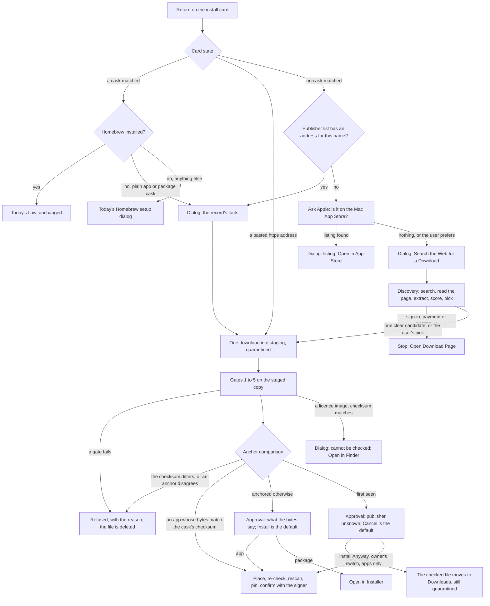

# Universal install

How the launcher installs an app that Homebrew lacks, or installs a Homebrew app on a Mac without
Homebrew, without weakening the installer that already works.

- **Status:** approved to start. On 2026-11-14 the owner settled D16, D28, D29 and D30 (section 8).
  The other decisions stand on their recommendations until he changes them. No source file has
  changed yet.
- **Basis:** the fork at `9e5fc31b`, and six research passes on 2026-11-13: the installer's source,
  the AI layer, the Mac App Store, macOS's own tools on this Mac (macOS 27.2), Homebrew's and
  Installomator's sources and data, and a red-team review of the first trust design. Four reviewers
  then attacked this document, and their findings are folded in. Outside facts were read from
  primary pages that day; section 12 lists them.
- **Not verified:** nothing was installed and no third-party installer was downloaded. Section 10
  lists each assumption that needs a hands-on run.
- **Related documents:** the installer this extends is `PROPOSED_ARCHITECTURE.md` section 4, its
  measured behaviour is in `BASELINE.md`, and the phases, steps and hours are in
  `IMPLEMENTATION_ROADMAP.md` (phases U1 to U5). Threats T14 to T21 and decisions D16 to D31 below
  continue the numbering of `RISKS_AND_DECISIONS.md` and move there in U1 step 1.

## 1. The plan in brief

Homebrew stays the first source and its flow does not change. Four things are added behind it:

1. **A native executor for disk images and zips**, so a cask can be installed on a Mac that has no
   Homebrew, and so a download from anywhere else has somewhere safe to go.
2. **The Mac App Store**, found through Apple's own search API and finished in the Store.
3. **Installer packages**, checked and then handed to macOS's Installer.
4. **Source discovery** for apps in no catalogue: a web search, the vendor's page read by the
   launcher itself, and a model used only to break a tie.

One rule holds all of it together: **a model or a web page may propose, and only fixed, reviewed
native code decides and acts.** A model returns a position in a list the launcher built. It never
supplies a link, a command, a path or a script.

### How far the launcher gets, case by case

"Returns" counts the presses after the one on the install card.

| The app is… | What happens | Returns |
| --- | --- | --- |
| A Homebrew cask, Homebrew installed | Today's flow, unchanged | 1 |
| A plain app cask with a checksum, no Homebrew (2,685 casks) | Approved once, downloaded, checked against Homebrew's checksum and installed natively. The completion message names the signer. | 1 |
| A plain app cask with no checksum, no Homebrew (364 casks) | Downloaded and checked. The signer is shown. Installed if the publisher is on record or pinned; otherwise as "publisher unknown" below. | 2 |
| A package cask, no Homebrew (up to 657 casks) | Downloaded, checked, described, opened in Installer. The user finishes there. | 2, then Installer |
| Any other cask, no Homebrew | Today's Homebrew setup dialog | – |
| On the Mac App Store | The Store opens on the product. The user clicks Get. The launcher confirms it arrived. | 1, then the Store |
| In no cask, but in the publisher list with a download address | Downloaded from that address with no web search. Installed only if the signature matches the recorded publisher. | 2 |
| In no catalogue with an address, publisher on record | Found on the web, downloaded, installed only if the signature matches | 2, or 3 when the user must pick a link |
| In no catalogue, publisher unknown | Found, downloaded and checked. The signer is shown. The user can keep the checked download. It is installed only if the owner's switch allows it. | 2 or 3, then a decision |
| An address the user pasted | As the two rows above, without the search | 1 |
| Behind a sign-in, a payment or a CAPTCHA | The launcher stops and offers the page | – |
| Unsigned, not notarized, or signed by someone other than the record says | Refused, with the reason | – |

Counts are from Homebrew's catalogue on 2026-11-13 (7,831 casks). "Plain" means exactly one app and
no other install step. The package count includes disabled casks and unsigned packages, which are
refused.

The success criterion asks that a missing cask does not end in failure or a browser. This plan meets
it wherever a catalogue or the Mac's own history can vouch for the publisher. Where nothing can, the
launcher still finds, downloads and checks the app, and then tells the truth: it does not know who
publishes it. It stops short of placing the app, not of obtaining it. Section 2 explains why that
last step cannot be automated honestly.

Two limits apply to friends in particular. Discovery needs a web search key, so without one only
the catalogue sources work (D30). And the unknown-publisher switch is the owner's: it is off, and
it has no place in Settings (D16).

### Terms

| Term | Meaning here |
| --- | --- |
| Quarantine | A mark macOS keeps on a downloaded file. It is what makes macOS check an app the first time it is opened. |
| Gatekeeper | The part of macOS that does that first-open check |
| Notarization | Apple's automated malware scan of a developer's build. It is not a review. |
| Developer ID, Team ID | The certificate Apple issues to a developer for apps sold outside the Store, and the ten-character identifier inside it |
| Seal check | Verifying an app's code signature over every file in it |
| Translocation | macOS running a quarantined app from a hidden, randomised path until the user moves it in Finder |
| App Management | The macOS permission an app needs to change another app |
| Adam ID, storefront | Apple's number for a Store product; the country whose Store is being asked |

## 2. Who is the legitimate publisher

The question: the agent's only evidence comes from untrusted pages, so how does the launcher decide
which publisher is the real one?

**It does not decide that from pages, at all.** No fact from a web page, a search result, a search
rank, a download address, a domain name or a model's judgement can make a download trusted. Trust
comes only from an **anchor**: a fact that a reviewed catalogue or this Mac's own history supplies,
compared by code against the bytes that were downloaded. Where no anchor exists, the launcher says
so and asks.

### 2.1 Anchors

| Anchor | What it fixes | Where it comes from | Reach |
| --- | --- | --- | --- |
| Cask checksum | The exact bytes | `sha256` in Homebrew's cask record, which a maintainer reviewed | 5,050 of 7,831 casks; the rest say `no_check` |
| Recorded publisher | The signer's Team ID | A table generated at build time from Installomator's labels (`expectedTeamID`), committed as data | 1,281 usable labels, 803 Team IDs. 594 of Installomator's 1,300 labels match no cask. |
| Pin | The signer's Team ID | What this Mac saw the last time the user approved an install of that app | Grows with use |

A Team ID is read from the downloaded bundle's signature by `Security.framework`. A web page cannot
supply it.

Installomator is the tool Mac administrators use to install vendor software. Each label records the
Team ID its maintainers expect, two maintainers review each change, and the tool itself refuses a
download whose Team ID differs. It is the largest public list that binds an app's name to its signer
for apps outside Homebrew; AutoPkg's recipes are a second (D25). Its licence is Apache-2.0.

**A download address is never an anchor**, including the one in a cask record. A cask with no
checksum fixes only where the download starts, and redirects may lead anywhere. If that address sits
on a storage bucket the vendor abandoned, whoever re-registered it serves the file. So a cask
without a checksum is trusted only through a recorded publisher or a pin (D24).

### 2.2 Three classes

Every download ends in exactly one class, decided by a pure function
(`SourceTrustPolicy.classify`, section 5.2).

| Class | When | What the user gets |
| --- | --- | --- |
| **Anchored** | Every gate passes; the bytes match the cask's checksum, or the Team ID is the recorded publisher's, or it is the pinned one; and no anchor disagrees | An app whose bytes match the checksum is installed with no second dialog (D29). Otherwise Install is the default button. |
| **First seen** | Every gate passes, no anchor exists, and none disagrees | The dialog says the publisher is unknown and shows the signer's legal name and Team ID. Cancel is the default. The user can keep the checked download or open the page it came from. Install Anyway exists only when the owner's switch is on (D16). |
| **Refused** | A gate fails; or any anchor names a different Team ID; or a checksum is present and differs | No install button, and the file is deleted. A publisher conflict offers no page. |

**Which names are looked up.** The publisher table and the pins are searched by four names: the name
the user typed, when there is one; the app's folder name, which is what lands in `/Applications`;
and the bundle's `CFBundleName` and `CFBundleDisplayName`. Each is folded first: compatibility
forms unified, other scripts transliterated to Latin, accents and case dropped, letters and digits
only. A look-alike spelling in another script therefore folds to the same entry and has to pass the
same comparison. The match after folding is exact, never fuzzy. If any looked-up name has an entry,
the Team ID must be in it. Labels that share a name pool their Team IDs.

**Pins** are found by bundle identifier and by folded folder name. A pin with a different Team ID
under either is a conflict.

**The model has no say.** `classify` takes no host, no search rank and no model output.

### 2.3 Gates

Gates are necessary and never sufficient. Passing all of them makes a download installable, not
trusted.

1. **Transport.** Every hop is `https` on the default port, with no user name in the address, a DNS
   host (no IP literal, no `xn--` label), and at most five redirects. The launcher follows redirects
   itself and records each hop.
2. **One download.** Streamed once into a private folder, hashed as it is written, capped at 4 GiB
   and by the free space on the disk, marked quarantined at once, and never fetched again.
3. **Shape.** The file type comes from its first and last bytes, never its name. A zip is scanned
   before it is expanded. A disk image must hold exactly one app. Symbolic links are never followed.
4. **Signature.** A strict, nested, every-architecture seal check with online revocation enforced,
   against the requirement "Developer ID and notarized".
5. **Identity.** The bundle identifier does not start `com.apple.`, no looked-up name folds to an
   Apple app's name, an arm64 slice exists, this macOS is new enough, the version is not older than
   the cask's, and no app with that name or identifier is already installed.
6. **Anchor comparison.** The only gate that can raise a download to Anchored.
7. **Placement.** The checked bundle still carries quarantine, is renamed into `/Applications` only
   if nothing is there, and its hash is compared again at the final path. Quarantine is never
   cleared and the launcher never opens the app.
8. **Packages only.** A Developer ID Installer signature that macOS's own policy accepts, then a
   listing of what the package would do, then Installer.

### 2.4 The three attacks named in the brief

**A fake download site that ranks above the real one.** Rank is not an input, and neither is the
host. Every search result is only a place to look, and what is found there is judged by its bytes.

- If a looked-up name has a recorded publisher or a pin, the fake build carries the attacker's Team
  ID, which differs. It is Refused, and the dialog says whose signature it carries. The launcher
  then offers to try the next result.
- If no name has an anchor, the fake build is First seen. Cancel is the default and nothing is
  installed. The dialog shows the signer's legal name and Team ID. A name unrelated to the app is a
  warning sign. A matching name proves nothing: registering a company under the app's name costs an
  attacker a few hundred dollars.
- Many 2025 and 2026 campaigns served no app at all. They showed a Terminal one-liner or an
  `applescript://` link. The launcher never runs a command from a page. It cannot stop a page it
  opens in the browser from showing one, which is why opening the page is never the default.
- Others served signed, notarized disk images (Odyssey, MacSync, CrashStealer). Those are what the
  classes above handle.

**Notarized malware.** Notarization is gate 4 and adds no trust. Apple describes it as an automated
malware scan and says it "is not App Review". Notarized malware is documented in 2020, 2021 (valid
for about four years), 2025 and 2026.

- The class comes only from gate 6. A notarized build signed with a throwaway Developer ID fails the
  comparison for any app with an anchor, and is First seen for the rest.
- Revocation is checked online at verification. That catches a certificate Apple has already
  revoked.
- Quarantine stays on the installed app, so Gatekeeper checks it again at first open. A ticket Apple
  revokes after the install still blocks the first launch.
- A pin means the next install under that bundle identifier or name must carry the same Team ID.

**Redirects to other domains.** A redirect is allowed when it meets gate 1 and is shown in the
dialog ("Downloaded from … via …"). **The final host never changes the class.**

- 55% of Homebrew's own casks download from a different registrable domain than their homepage
  (4,284 of 7,831; 3,274 of them from github.com). A same-domain rule would reject most real
  vendors.
- A list of "safe" hosts would be wrong in the other direction: anyone can upload to GitHub or to a
  storage bucket, and abandoned bucket names have been re-registered and served `.dmg` files.
- So a redirect to a vendor's content network and a redirect to a hostile host are treated the same
  way: the bytes that arrive must pass the gates, and only an anchor makes them trusted. If the
  official page's button leads to a bucket an attacker now owns, the attacker's build fails the Team
  ID comparison where an anchor exists, and is First seen where none does.

### 2.5 Considered and dropped

The first design had a middle class, "corroborated", for a download from a domain that an
independent source named as official. The red-team pass broke every source of that kind.

| Idea | Why it was dropped |
| --- | --- |
| The App Store listing's `sellerUrl` as the official domain | Apple does not verify it. Any enrolled developer can publish a small app with any address. It is also often missing: Maccy's is null, and its Store seller differs from its Developer ID signer. |
| Wikidata's official-website property | Small items are unprotected. Anyone can edit the address or create a matching item. |
| Matching the certificate's organisation to the publisher's name | Legal names are unrelated to app names (Obsidian is signed by Dynalist Inc.) and a look-alike company costs a few hundred dollars. |
| A minimum domain age | A domain bought at auction keeps its registration date. No age data exists for `.io`, `.md`, `.me`, `.sh`, `.de` and others. The 2026 fake Homebrew page sat on `sites.google.com`. |
| A look-alike check against the official domain | Needs an official domain, which nothing above supplies. |
| A list of trusted download hosts | See redirects. |
| A cask record's download address as an anchor | See section 2.1. |
| Homebrew's `verified:` stanza | Removed from Homebrew in July 2026. |

Each of the first five also sent the typed name to one more service. Dropping them removes Wikidata,
a domain registry and a public-suffix list from the design.

### 2.6 What this cannot protect against

- A vendor's own compromised build, signed with its own certificate (3CX, 2023). Only a checksum
  mismatch, Apple's revocation, or time can catch it.
- A compromised Homebrew, Installomator or Apple.
- A different product from the same publisher. One Team ID can cover dozens of apps (Microsoft's
  covers 36 labels). The approval's title comes from the bundle, and it shows the bundle identifier,
  so the user can notice.
- A genuine, correctly signed app that is not the one the user meant.
- A company registered under the app's own name, for an app with no anchor.
- Look-alike spellings within the Latin alphabet ("Obsldian"). Folding catches other scripts, not
  these.
- A vendor that changes its Team ID, after an acquisition or a re-sign. It is refused until the
  table is regenerated or the user forgets that app's pin. An unrelated app that shares a recorded
  app's exact name is refused for the same reason.
- What a package's scripts do as administrator, and what an installer app downloads after it opens.
- An older genuine build with a known hole, when no cask record gives a version to compare.
- The page a user chooses to open from a First seen dialog.
- Malware already running as the user, which can edit the pins or the staging folder.
- The whole unanchored tail, where the decision rests on a person reading a legal name.

## 3. The current installer, and the smallest changes

Read from `Tinycast/Features/PackageInstall/` (1,533 lines) and its four harnesses.

### 3.1 What is tied to Homebrew

| Neutral as it stands | Tied to Homebrew |
| --- | --- |
| `InstallIntent`, `PackageInstallSettingsStore` | `CaskIndex`, `CaskRecord`, `CaskToken`, `BrewInvocation`, `InstalledCask` |
| `InstallVerification.judge`, apart from one field name | `InstallPlan` (every installing case holds a `BrewInvocation`), `InstallApproval` |
| `InstallVerifier`'s seal check (`isTrusted`, private today) | `InstallVerifier.observe(record:)`, `CaskAPI`, `CaskIndexStore`, `HomebrewEnvironment`, `CaskInstaller` |
| The coordinator's skeleton: one flow at a time, the generation counter, the lookup pill, the output window, `conclude`, the rescan, `offerOpen` | The coordinator's `run`, `lookUp`, `present`, `runInstall` and `finish`; `TerminalHandoff.run` |

### 3.2 Where the flow ends today without an install

These are the hooks. Each later phase attaches to one.

| Dead end | Where | What attaches |
| --- | --- | --- |
| The card says "No cask matches" and Return does nothing | `PackageCandidate.hasAction`, `PackageInstallCoordinator.activate`, `PackageActionsMenu.content` | U2: a recorded download address. U3: look on the App Store. U5: search the web. |
| Homebrew is missing: a dialog with the setup command | `InstallPlan.homebrewMissing`, `offerHomebrewSetup` | U2: install the cask's own download natively. U4: the same for a package cask. |
| A cask disabled as "moved to the Mac App Store" | `CaskRecord.Retirement.Reason.movedToMacAppStore` | U3: one more button on the notice |
| The record is gone (`CaskAPI.Failure.notFound`) | `reportLookupFailure` | U3 and U5: treated as no match |

### 3.3 The shape: closed enums, not a provider protocol

A protocol with one type per provider is the plugin framework `MVP_SCOPE.md` excludes and the
speculative abstraction `AGENTS.md` forbids. It needs existential types (values whose concrete type
is hidden behind the protocol), a registry beside `AppCore`, and it hides which dialog each provider
shows. The fork instead adds cases to the feature's own enums, in the spirit of ground rule 1 of
`PROPOSED_ARCHITECTURE.md`, and each case arrives with the code that executes it:

- `InstallSource`, new: what Return acts on and what Run Again repeats. `.homebrew(token:)` and
  `.download(DownloadOffer)` in U2, `.appStore(AppStoreListing)` in U3.
- `InstallPlan` gains `.download`, then `.openAppStore`, then `.openInstaller`.
  `make(record:facts:)` keeps its behaviour; a second factory handles an offer.
- `PackageCandidate.State` gains `.link(URL)` for a pasted address, and `hasAction` widens.

### 3.4 No line changes in the launcher's own files

Traced in the source, and checked again by a reviewer:

- Return reaches `PackageInstallCoordinator.activate` with no other check, so that function alone
  decides whether Return acts.
- The footer pill and the Cmd-K menu follow `PackageCandidate.hasAction`,
  `PackageActionsMenu.primaryTitle` and `PackageActionsMenu.content`.
- No file outside `PackageInstall/` reads the card's state or switches over `InstallPlan`, so a new
  state or plan case costs nothing in `LauncherScreen.swift`, `LauncherList.swift` or
  `RootPaletteView.swift`.

One invariant must hold: whenever `hasAction` is true, `content` returns a menu. Today both are true
only for a match. What Cmd-K does over a nil menu is not known (section 10, row 9).

Section 9 gives the seam budget. The upstream-owned lines are two in `AppCore.swift` in U2 and one
or two more in U5, the harness entries, an appended notice, and strings. `project.pbxproj` is
regenerated whenever a Swift file is added.

### 3.5 Upstream code to reuse

| Code | Reuse |
| --- | --- |
| `ToolRunner` (`Features/Updates/Service/`) | Call as it stands for `ditto`, `diskutil`, `pkgutil` and `spctl`: an absolute path, an argument array, a timeout, no shell. `AppleShortcutRunner` already calls it from another feature. No harness compiles it yet. |
| `BundleSignature.developerID` | Call as it stands. Its check flags and `uniqueHash` are private, so they are restated, as `InstallVerifier` does today. |
| `UpdateDownloader`, `UpdateInstaller` | Copy the shape (delegate plus stream; stage, `ditto`, hash, then swap). They are tied to Tinycast's own release and cannot be stubbed in a harness. |
| `Quarantine.clear` | **Never call it.** It exists so a self-update shows no first-open prompt. A third-party app needs the opposite. `Quarantine.isSet` is fine. |
| `CommandOutputPresenter` | The progress surface. No determinate progress bar exists that a feature can borrow, and the progress pill costs about 50 MB, so a download writes "12.0 MB of 80.1 MB" lines to the output window. Stop cancels the transfer. |
| `AppCore.choose`, `confirm`, `showNotice`, `reportFailure` | Every dialog. `choose` takes any number of buttons, the last being Cancel, and its `defaultIndex` is how a class changes the default. |
| `AppLauncher.open`, `NSWorkspace` | The Store link and the Installer hand-off, as `TerminalHandoff` opens Terminal |
| `ScriptRomanization` (`Features/Launcher/Model/`) | The Latin transliteration for name folding. The install harnesses already compile it. |
| `ShellCommandRunner` | **Not used by the new executors.** It always starts a login shell. |

Nothing in the app parses web pages, and nothing imports WebKit. A link extractor is new code.

### 3.6 Where the planning documents and the code already disagree

To fix in phase U1:

- `docs/features/package-install.md` does not exist, though the roadmap lists it under Phase 1.
- `PROPOSED_ARCHITECTURE.md`, four places. Section 4.3 still shows the old script and says "two
  positional values"; the code is `"$1" "$2" --cask "$3"`. Section 4.8's `PackageInstallFailure`
  enum was never written; failures are mapped inline. Section 4.2 says `CaskIndex.generatedAt`; the
  code says `fetchedAt`. Section 4.1 says `InstallVerifier` uses `BundleSignature`; it uses only the
  `developerID` constant.
- `RISKS_AND_DECISIONS.md` T4 also says "two positional values".

To fix in phase U2, because a second source makes them wrong:

- The settings section's title "Install apps with Homebrew", its header "Homebrew", and its promise
  that "An app's name goes to Homebrew only when you press Return".

## 4. The flow

Typing still reads memory only. Every network request below follows a Return.



Five rules shape it.

- **A native install has two moments, with one exception.** Before the download, a consent that
  shows what a catalogue says, or for a pasted address the card itself. After the check, an approval
  that shows what the bytes say: the signer, the class, where it installs and what it needs. Nothing
  is fetched after it.
- **The exception (D29).** For a plain app cask with a checksum, the first dialog is the approval.
  The app is installed as soon as the bytes match the checksum and every gate passes, and the
  completion message names the signer and what the app declares. The checksum fixed the bytes before
  they were fetched, so what was approved cannot differ from what is installed. A mismatch, a failed
  gate or a disagreeing anchor still refuses, with no install and no pin. Two cases leave the
  exception. A package always gets the consent and then its own dialog, because that is the only
  place its scripts and background items are listed. A disk image with a licence agreement cannot be
  checked inside, so it gets its own dialog after the download (section 5.3).
- **The first Return contacts only Homebrew and Apple.** A vendor's server is contacted only after
  that first dialog. A web search and a visit to an unknown site happen only after a further,
  labelled choice (D30).
- **A failure never becomes a silent fallback.** A refused download does not quietly try the next
  source. In discovery, the refusal offers "Try Next Result" and waits.
- **Homebrew's own flow keeps its single approval.** It is unchanged.

## 5. Components and interfaces

Everything is added inside `Tinycast/Features/PackageInstall/`. Names are sketches and follow
upstream's suffix table where one fits.

### 5.1 Components

| Type | Layer | Isolation | Responsibility | Phase |
| --- | --- | --- | --- | --- |
| `ArtifactEvidence`, `SourceTrust`, `DownloadOrigin`, `PublisherPin` | Model | `Sendable` values | What was observed about a download; its class; where its address came from; one remembered signer | U1 |
| `SourceTrustPolicy`, `PublisherName` | Model | pure | Class from evidence, origin and anchors; name folding | U1 |
| `HopPolicy` | Model | pure | Gate 1 over a redirect chain | U1 |
| `TeamAnchors` (generated) | Model | static data | App name to recorded Team IDs and, where literal, a download address | U1 |
| `InstallSource`, `DownloadOffer` | Model | `Sendable` values | What Return acts on; one proposed download | U2 |
| `ArtifactKind`, `DiskImageTrailer`, `ZipDirectory`, `StagedContents` | Model | pure | File type from bytes; licence or encryption; zip safety; which app to take | U2 |
| `DownloadApproval` | Model | pure | Each dialog's text, buttons and default | U2 |
| `ArtifactDownloader` | Service | nonisolated, stream | Gate 2 | U2 |
| `DiskImageService`, `ZipArchiveService` | Service | `@concurrent` statics | Attach and detach; expand | U2 |
| `BundleInspector` | Service | `@concurrent` statics | Gates 4 and 5: seal, Team ID, signer name, `Info.plist` facts | U2 |
| `AppPlacer` | Service | `@concurrent` statics | Gate 7 | U2 |
| `PublisherPinStore` | Service | `@MainActor @Observable` | Persist pins; owned by `AppCore` | U2 |
| `AppStoreListing` | Model | `Sendable` value | One Store record; exact-name choice | U3 |
| `AppStoreAPI` | Service | `@concurrent` statics | Apple's search | U3 |
| `AppStoreArrivalMonitor` | Service | `@MainActor` | Notice that the Store finished | U3 |
| `PackageSummary`, `PackageSignature` | Model | pure | What a package would do; who signed it | U4 |
| `PackageInspector`, `InstallerHandoff` | Service | `@concurrent`, `@MainActor` | Gate 8; open Installer | U4 |
| `LinkExtractor`, `DownloadCandidate`, `CandidateScorer`, `PageWall`, `PickPrompt` | Model | pure | Links from a page; one scored link; their order; sign-in, payment and CAPTCHA detection; the model's list and its answer | U5 |
| `PageFetcher`, `SourceDiscovery` | Service | `@concurrent` statics | Read one page; run the discovery steps | U5 |
| `DownloadLinkPicker` | Service | `@concurrent` statics | One on-device call that returns a position | U5 |

No new actor, no second owner, and no file under `Model/` imports more than Foundation.
`@concurrent` marks a function that runs off the main thread; `nonisolated` marks one that belongs
to no actor. Both are used the way the existing install code uses them.

### 5.2 Trust (U1)

```swift
// Model/DownloadOrigin.swift
/// Where a download's address came from. It decides which anchors can apply, never the class.
enum DownloadOrigin: Sendable, Equatable {
    /// `checksum` is nil for a cask whose record says `no_check`.
    case caskRecord(token: String, checksum: String?, version: String?)
    /// A literal address from the publisher table.
    case recorded(name: String)
    case pasted
    case discovered(page: URL)
}

// Model/ArtifactEvidence.swift
struct ArtifactEvidence: Sendable, Equatable {
    struct Signature: Sendable, Equatable {
        let teamID: String
        /// The leaf certificate's legal name: a company, or a person.
        let signerName: String
    }
    let sha256: String
    let hops: [URL]
    /// Nil when unsigned, ad hoc, broken, revoked, not Developer ID or not notarized.
    let signature: Signature?
    /// "Obsidian" for `Obsidian.app`: the name it would be installed under.
    let folderName: String
    let bundleName: String?
    let displayName: String?
    let bundleID: String
    let version: String
    let hasArm64: Bool
    let minimumSystem: String?
    let isQuarantined: Bool
}

// Model/PublisherPin.swift
struct PublisherPin: Sendable, Equatable, Codable {
    let bundleID: String
    let foldedName: String
    let teamID: String
    let signerName: String
    let approvedAt: Date
}

// Model/SourceTrust.swift
enum SourceTrust: Sendable, Equatable {
    enum Anchor: Sendable, Equatable {
        case caskChecksum(token: String), recordedPublisher(name: String), pin(since: Date)
    }
    /// Which anchor disagreed, so the dialog can name it.
    enum AnchorSource: Sendable, Equatable { case table(name: String), pin(since: Date) }
    enum Refusal: Sendable, Equatable {
        case transport(HopPolicy.Refusal), checksumMismatch, notSignedAndNotarized
        case publisherChanged(recorded: Set<String>, source: AnchorSource)
        case shadowsApple, noArm64, needsNewerSystem(String), olderThanCatalogue(String)
        case alreadyInstalled, notQuarantined
    }
    case anchored(Anchor)
    case firstSeen
    case refused(Refusal)
}

// Model/SourceTrustPolicy.swift
enum SourceTrustPolicy {
    struct Facts: Sendable, Equatable {
        let recordedPublishers: [String: Set<String>]   // TeamAnchors, by folded name
        let pins: [PublisherPin]
        let presentAppNames: Set<String>
        let presentBundleIDs: Set<String>
        let appleAppNames: Set<String>
        let systemVersion: String
    }
    /// Pure. A host, a search rank and a model's pick are not parameters.
    static func classify(_ evidence: ArtifactEvidence, typedName: String?,
        origin: DownloadOrigin, facts: Facts) -> SourceTrust
}

// Model/PublisherName.swift
enum PublisherName {
    /// Compatibility forms unified, Latin transliteration, no accents, lower case, letters and
    /// digits only.
    static func fold(_ name: String) -> String
}

// Model/HopPolicy.swift
enum HopPolicy {
    static let maximumRedirects = 5
    enum Refusal: Sendable, Equatable {
        case notHTTPS(hop: Int), userName(hop: Int), port(hop: Int), addressLiteral(hop: Int)
        case punycode(hop: Int), tooManyRedirects
    }
    static func judge(_ hops: [URL]) -> Refusal?
}
```

The checksum anchor can be reached only from `.caskRecord` with a checksum. Recorded Team IDs come
only from `Facts.recordedPublishers`, so there is one source of truth for them.

**The publisher table.** `Scripts/fork/gen-team-anchors.js` reads the label files of a pinned
Installomator commit as text. It never executes a label.

- It accepts a file only if it holds exactly one literal `name="…"` and one `expectedTeamID` of
  exactly ten letters and digits.
- It also keeps the label's `downloadURL` when that is one literal `https` string with no `$`, no
  backtick and no space. 504 such lines exist; 681 labels compute theirs in shell and are skipped.
  A recorded address is only a place to start. The download is judged like any other and is refused
  unless its Team ID matches.
- It prints every Team ID that changed since the last run, for the owner to read before committing.
- A `--self-test` mode feeds it hostile label text and checks that nothing but ten-character IDs and
  literal addresses comes out.
- It is run again before every fork release, because Team IDs do change.

The output is `TeamAnchors.generated.swift`, never hand-edited. Installomator's Apache-2.0 notice is
appended to `NOTICE.md`.

### 5.3 Downloads (U2)

```swift
// Model/DownloadOffer.swift
struct DownloadOffer: Sendable, Equatable {
    let url: URL
    let origin: DownloadOrigin
    let typedName: String?
    /// From the cask record when there is one. Text for the dialog, never a path.
    let displayName: String?
    let appName: String?
    /// Nil unless the address passes `HopPolicy`.
    init?(url: URL, origin: DownloadOrigin, typedName: String?, displayName: String? = nil,
          appName: String? = nil)
}

// Model/ArtifactKind.swift
enum ArtifactKind: Sendable, Equatable {
    case diskImage, encryptedDiskImage, zip, flatPackage
    /// `koly` 512 bytes from the end, `encrcdsa`, `PK\u{3}\u{4}`, or `xar!`.
    static func detect(head: Data, tail: Data) -> ArtifactKind?
}

// Model/ZipDirectory.swift
struct ZipDirectory: Sendable, Equatable {
    enum Danger: Sendable, Equatable { case tooManyEntries, tooLarge, escapingPath, absolutePath }
    static let entryLimit = 20_000
    static let sizeLimit: Int64 = 8 << 30
    /// Reads every header of the central directory, ZIP64 included. Nothing is expanded.
    static func read(endRecord: Data, centralDirectory: Data) throws -> ZipDirectory
    var danger: Danger? { get }
}

// Model/StagedContents.swift
enum StagedContents: Sendable, Equatable {
    struct Entry: Sendable, Equatable { let name: String; let isDirectory: Bool; let isLink: Bool }
    case app(String)
    case package(String)
    case severalApps([String])
    case nothingInstallable
    /// Links are skipped, so a disk image's `Applications` shortcut is never followed.
    static func choose(from entries: [Entry], named appName: String?) -> StagedContents
}

// Model/DownloadApproval.swift
enum DownloadApproval {
    struct Button: Sendable, Equatable { let title: String; let isCancel: Bool }
    struct Dialog: Sendable, Equatable {
        let title: String
        let message: String
        let buttons: [Button]
        let defaultIndex: Int
    }
    /// The one dialog of a plain app cask with a checksum (D29), or the consent before any other
    /// download, a package cask included.
    static func beforeDownload(for offer: DownloadOffer, record: CaskRecord?) -> Dialog
    /// Nil only when an app's bytes matched the cask's checksum: no second dialog is needed.
    static func approval(_ evidence: ArtifactEvidence, trust: SourceTrust, offer: DownloadOffer,
        allowsUnknownPublishers: Bool) -> Dialog?
    /// Names the signer, then what the app declares.
    static func completion(_ evidence: ArtifactEvidence, declares: [String]) -> String
}
```

`DownloadApproval` returns its own value, not upstream's `DialogAction`, because the harnesses that
compile `Model/` do not compile the dialog. The coordinator maps it.

```swift
// Service/ArtifactDownloader.swift
enum ArtifactDownloader {
    struct Staged: Sendable, Equatable {
        let file: URL
        let sha256: String
        let hops: [URL]
        let kind: ArtifactKind
    }
    enum Event: Sendable { case progress(received: Int64, expected: Int64?), finished(Staged) }
    enum Failure: Error, Equatable {
        case refusedHop(HopPolicy.Refusal), status(Int), tooLarge, unknownType, offline, noSpace
    }
    /// One data task on a private ephemeral session with no cache and no cookies.
    nonisolated static func download(_ offer: DownloadOffer, into staging: URL,
        limit: Int64 = 4 << 30, protocolClasses: [AnyClass]? = nil)
        -> AsyncThrowingStream<Event, any Error>
}

// Service/DiskImageService.swift
enum DiskImageService {
    /// `/usr/sbin/diskutil image attach --plist --readOnly --nobrowse --mountPoint`, by ToolRunner.
    @concurrent nonisolated static func attach(_ image: URL, at mountPoint: URL) async throws -> URL
    @concurrent nonisolated static func detach(_ mountPoint: URL) async
}

// Service/BundleInspector.swift
enum BundleInspector {
    struct Declarations: Sendable, Equatable {
        /// From the bundle's usage-description keys: camera, microphone, and so on.
        let mayAskFor: [String]
        /// Login items, launch agents and system extensions inside the bundle.
        let adds: [String]
        let updatesItself: Bool
    }
    @concurrent nonisolated static func inspect(_ bundle: URL, staged: ArtifactDownloader.Staged)
        async -> (ArtifactEvidence, Declarations)
    /// The seal's unique hash, compared again after the move.
    nonisolated static func uniqueHash(of bundle: URL) -> Data?
}

// Service/AppPlacer.swift
enum AppPlacer {
    enum Failure: Error, Equatable { case occupied, notWritable, changedAfterCheck, notQuarantined }
    @concurrent nonisolated static func place(_ staged: URL, named name: String, expecting: Data,
        applications: URL = URL(fileURLWithPath: "/Applications")) async throws -> URL
}

// Service/PublisherPinStore.swift
@MainActor @Observable
final class PublisherPinStore {
    private(set) var pins: [PublisherPin]
    /// A file under Application Support, keyed by `Bundle.main.bundleIdentifier`.
    init(fileURL: URL)
    func record(_ pin: PublisherPin)
    func forget(bundleID: String)
    func reset()
}
```

Details that the sketches do not show:

- **The download.** A data task, not a download task, so each chunk is written and hashed in one
  pass, the type is checked on the first chunk, and the task is cancelled the moment the cap is
  passed. Only status 200 is accepted. `urlSession(_:task:willPerformHTTPRedirection:…)` applies
  `HopPolicy` to each hop. The file's name on disk is generated; a server's suggested name is only
  ever shown as text.
- **Quarantine.** The app does not quarantine what it writes, so the downloader sets
  `URLResourceValues.quarantineProperties` (web download, the agent name, the download address and
  the origin page) as soon as the file exists, as Homebrew does. Measured on this Mac: a quarantined
  image mounts with the quarantine flag, and copies made from it by `FileManager.copyItem`, `ditto`
  and `cp` all carry the attribute; `ditto -x -k` does the same for a quarantined zip. The placer
  still checks for the attribute and does not assume it.
- **Staging.** A private `0700` folder from `FileManager.url(for: .itemReplacementDirectory, …,
  appropriateFor: /Applications)`, so it is on the same volume and the final step is a rename.
  Staging is deleted on every exit, and stale staging is swept on first use, not at launch.
- **Disk images.** `hdiutil` is deprecated on macOS 27, and its attach, create and image-info verbs
  print a warning, so the executor uses `diskutil image attach`. That tool does not verify an
  image's own checksums: it mounted a deliberately corrupted image that `hdiutil` refused. Integrity
  therefore comes from the cask's checksum where there is one, and always from the strict seal check
  of the app inside. `DiskImageTrailer` reads the image's trailer before mounting. An encrypted
  image is refused, and so is one with more than one volume.
- **A disk image with a licence agreement** cannot be attached without accepting it, so its contents
  cannot be checked. If its bytes do not match a cask checksum, it is refused, with the reason. If
  they do, the launcher asks in its own dialog: the image has a licence agreement, the app inside
  could not be checked, open it in Finder? The buttons are Open in Finder and Cancel, which is the
  default. Finder then shows the agreement itself. Nothing is placed and no pin is written. The
  launcher never strips or auto-accepts an agreement (D22).
- **Zips.** `ZipDirectory` bounds the entry count and total size first. `ditto -x -k` then expands
  into a new private folder. On this Mac it kept `../` entries inside the target, but it restores
  symbolic links faithfully, so the expanded tree is walked with `lstat` and refused if it holds an
  absolute link, a link that leaves the tree, a hard link or a setuid bit.
- **Fresh installs only.** The move fails if anything is at the target. macOS refuses the fork's
  replacement of an existing app without a prompt (`BASELINE.md`, row 7), and an app already present
  is offered for opening, as today.
- **Standard users.** `/Applications` is writable by administrators only. A standard user's install
  goes to `~/Applications` (section 10, row 10).
- **Keep Download.** For a First seen result, the checked file can be moved, still quarantined, to
  `~/Downloads` and shown in Finder. The user then opens it as they would a browser download, and
  Gatekeeper checks it as usual. Nothing is placed in `/Applications`.
- **After placing.** The existing rescan and confirmation run, and the confirmation names the
  signer. A pin is written after an approval that showed the signer, or after a checksum-matched
  install, with the signer its completion message names. A refused or stopped install writes none.
- **Updates.** Nothing updates an app the launcher installed natively unless the app updates itself.
  About half of the plain casks do (1,586 of 3,166 are marked `auto_updates`). The approval says
  which is the case, and so does the one dialog of a checksum cask.
- **Packages before U4.** A pasted package, or an image holding only a package, is refused in U2
  with "Installer packages are not supported yet".

### 5.4 The dialogs

One plain message each, as `DialogView` draws them. Every value comes from a catalogue record, the
checked bytes, or the recorded transfer (the hosts). None comes from page text. The Rectangle and
Obsidian values below are real; "Example" names are invented for illustration.

**The one dialog** for a plain app cask with a checksum, on a Mac without Homebrew (D29):

```text
Install Rectangle?

Rectangle 2.0.4 · Move and resize windows using keyboard shortcuts or snap areas
Source: rectangleapp.com, listed by Homebrew as "rectangle"
Download from: github.com
Installed only if it matches Homebrew's SHA-256 and passes the signature checks.
Installs to: /Applications/Rectangle.app, nothing replaced
Needs: no password. Updates itself. macOS checks the app when you first open it.
```

Buttons: Install (default), Set Up Homebrew Instead, Cancel. When the install finishes, the message
and the output window's last line take the form "<App> is installed. Signed by <legal name> (<Team
ID>).", followed by the app's "May ask for" and "Adds" lines, and a note if the app will run from a
randomised path (D17).

**Consent**, before any other download. For a cask with no checksum, or any package cask:

```text
Download Example Notes to check it?

Example Notes 1.2.0 · Notes in plain text
Source: example.com, listed by Homebrew as "example-notes"
Download from: dl.example.com
Homebrew publishes no checksum for it, so the signer decides.
Nothing is installed until you approve the result.
```

Buttons: Download and Check, Set Up Homebrew Instead, Cancel. For a recorded address the source
line reads "from the publisher list (Installomator)".

**Approval**, after the check, anchored by its publisher. Here the download came from a recorded
address:

```text
Install Obsidian?

Signed by the publisher on record for Obsidian (Installomator's list).
Signed by: Dynalist Inc. (6JSW4SJWN9), notarized by Apple
md.obsidian 1.15.1, Apple silicon
Downloaded from: release-assets.githubusercontent.com, via github.com
Installs to: /Applications/Obsidian.app, nothing replaced
Needs: no password. May ask for: automation, audio capture, Bluetooth, calendars and 5 more.
Updates itself. macOS checks the app when you first open it.
```

Buttons: Install (default), Cancel. The second line names the anchor: the recorded publisher, or
"The same publisher as your install on 2 November".

**Approval**, first seen:

```text
Install Example Notes?

The launcher doesn't know who publishes this app.
Signed by: Jordan Example (ABCDE12345), notarized by Apple
com.example.notes 1.2.0, Apple silicon
Downloaded from: dl.example.com, found on example.com
Would install to: /Applications/Example Notes.app, nothing replaced
May ask for: screen recording. Adds: a login item.
```

Buttons, in order: Install Anyway (only with the owner's hidden switch, D16), Keep Download, Open
example.com, Cancel (default). The page button names the host. For a pasted address there is no
page button.

**Refused** for a publisher conflict:

```text
Not installing Obsidian

This download is signed by Jordan Example (ABCDE12345).
The publisher on record for Obsidian has Team ID 6JSW4SJWN9 (Installomator's list).
Downloaded from: obsidian-app.example
The file was deleted.
```

The table holds Team IDs, not legal names, so only the downloaded signer has a name here. In
discovery the buttons are Try Next Result and OK; otherwise one button. No page is offered.

`DownloadApproval` returns the buttons and the default, so a harness can pin three things. After a
check, Install is the default only when anchored. A first seen dialog never defaults to Install or
to a page. Before a download, only the one dialog of a plain app cask with a checksum defaults to
Install.

The "May ask for" and "Adds" lines list what the app itself declares. They are not a promise about
what it does.

### 5.5 Mac App Store (U3)

**What a command line can do.** mas-cli 7.0.0 (2026-05-04) is the only tool. Its limits decide the
design:

| Case | From a command line | The Store window | The launcher |
| --- | --- | --- | --- |
| Free, already obtained by this account | `mas install`, which needs root | Not needed | Open the Store page |
| Free, never obtained | `mas get`, which needs root and may need Touch ID or the account password per app; fails in some storefronts | Not needed when it works | Open the Store page |
| Paid, already bought | `mas install` | Not needed | Open the Store page |
| Paid, not bought | Impossible: mas cannot buy | Required, with payment | Open the Store page; show the price |
| Needs a newer macOS | Fails | Shows why | Stop, with the reason |
| An iPhone or iPad app offered on Mac | Unsupported | Required | Open the Store page |
| Not signed in to the Store | Fails; mas cannot sign in | Required | Open the Store page |

mas needs root because of a restriction Apple added in macOS 26.1, and it gets root by running
`sudo` on itself. It relies on two private frameworks that have broken on three macOS updates, and
its maintainer said on 2026-10-28 that no new version ships until 8.0.0 is finished. It could run
only as a Terminal hand-off. For the reasons in D18, **the first version always opens the Store**.

One other supported route is not yet understood. The App Store app on macOS 27.2 ships an "Install
Application" action for Shortcuts. If a shortcut can pass it a product number, it might start an
install without mas or root. That needs a run (section 10, row 17, and D31).

**Discovery** uses Apple's search API directly: `https://itunes.apple.com/search` with
`media=software`, `entity=desktopSoftware`, a country and a limit, on a private ephemeral session.
`entity=macSoftware` is not a documented value and returned iPhone records. The limit is about 20
calls a minute, which one request per Return never approaches.

Name search is a hint and never an identity: a search for "xcode" does not return Xcode, and
copycat sellers rank beside the real app. So the launcher installs nothing from this result. It
takes an exact, case-folded name match if there is one, otherwise shows up to three listings to
choose from, and always shows the seller, the price and the bundle identifier.

```swift
// Model/AppStoreListing.swift
struct AppStoreListing: Sendable, Equatable {
    /// Apple's `trackId`. Digits from Apple's reply, never from typed or web text.
    let adamID: Int
    let name: String
    let bundleID: String
    let sellerName: String
    let formattedPrice: String
    let isFree: Bool
    let version: String
    let minimumSystem: String
    let storefront: String
    /// `macappstore://apps.apple.com/<storefront>/app/id<adamID>?mt=12`
    var storeURL: URL { get }
    static func decode(search data: Data, storefront: String) throws -> [AppStoreListing]
    static func exactMatch(for name: String, in listings: [AppStoreListing]) -> AppStoreListing?
}

// Service/AppStoreAPI.swift
enum AppStoreAPI {
    enum Failure: Error, Equatable { case unavailable, malformed }
    @concurrent nonisolated static func search(_ name: String, storefront: String,
        baseURL: URL = base, session: URLSession) async throws -> [AppStoreListing]
}

// Service/AppStoreArrivalMonitor.swift
@MainActor
final class AppStoreArrivalMonitor {
    /// A live Spotlight query for the listing's Adam ID under /Applications, for 30 minutes.
    func watch(_ listing: AppStoreListing, onArrival: @escaping @MainActor (URL) -> Void)
    func stop()
}
```

**The hand-off.** The App Store registers the `macappstore` scheme; an `https://apps.apple.com` link
opens the browser. The user clicks Get or Buy, authenticates and pays there. Nothing is automated.

**Afterwards.** The monitor notices the app. Verification is new, because today's
`InstallVerifier.trustedSigner` rejects every Store app: the requirement is
`anchor apple generic and certificate leaf[field.1.2.840.113635.100.6.1.9] exists and identifier
"<bundleID from Apple>"`, with the same strict flags. A `_MASReceipt` folder alone proves nothing;
two apps on this Mac have fake ones.

**The storefront** is `Locale.current.region`, which is what mas does. A wrong storefront shows a
wrong price or "not available". Whether StoreKit's `Storefront.current` works in an app that is not
from the Store is not known (section 10, row 14).

### 5.6 Packages (U4)

A package can run scripts as administrator, so it gets the most caution and the least automation.

**Checks**, all through `ToolRunner` with fixed arguments, on the staged, quarantined file:

1. `pkgutil --check-signature`: the leaf must be a Developer ID Installer, and the output must say
   the package is notarized. `Security.framework` cannot read a package's signature, so this text is
   the only source. The Team ID is the final parenthesised group of the leaf's line, anchored at the
   end of the line, because the legal name before it is chosen by the signer.
2. `spctl -a -vv -t install`: macOS's own policy must accept it, and the Team ID in its `origin=`
   line must equal the one from step 1. Any disagreement, or text that does not parse, is a refusal.
3. The Team ID goes through the same anchor comparison as an app's.
4. `pkgutil --expand` into scratch (never `--expand-full`) and `pkgutil --payload-files`. Nothing is
   run, and `installer(8)` is not used at all.

An unsigned or un-notarized package is refused. That is stricter than Homebrew, which installs
unsigned packages.

**The package dialog** is shown after the checks, for every package, from `PackageSummary`. D29's
exception does not apply to packages:

```text
Open the Example Tools installer?

The download matches Homebrew's checksum for "example-tools".
Signed by: Example Software Inc. (ABCDE12345), notarized by Apple
Installs: com.example.tools.pkg to /Applications
Needs: your administrator password, asked by Installer
Runs: its own scripts as administrator; the launcher can't list what they do
Adds: a background item that starts with the Mac
```

The names in this example are invented.

The "Adds" line appears for payload paths under `Library/LaunchDaemons`, `Library/LaunchAgents`,
`Library/PrivilegedHelperTools`, and for system or kernel extensions.

**Classes apply more strictly than for apps.** Open Installer is offered, and is the default, only
when the package is Anchored. A First seen package gets Keep Download and Cancel, whatever the
owner's switch says: the launcher does not open Installer on an unknown signer's scripts.

**The install** is `NSWorkspace` opening the package with
`/System/Library/CoreServices/Installer.app`, named by path. The file's SHA-256 is compared with the
downloaded hash immediately before the hand-off. Installer shows the licence, the choices and
macOS's own password dialog. The alternative, `sudo installer` in Terminal, skips the licence and
runs scripts with nothing shown, so it is rejected. No askpass helper, no privileged helper.

**Afterwards.** The package's identifiers get a receipt (`pkgutil --pkg-info-plist`). The launcher
checks for it on the next launcher show and for a bounded time after the hand-off, then checks any
installed app's seal and rescans.

With Homebrew installed, a package cask keeps today's Terminal hand-off. This phase covers the Mac
without Homebrew, a package inside a disk image, and a pasted or discovered package.

```swift
// Model/PackageSignature.swift
struct PackageSignature: Sendable, Equatable {
    let signerName: String
    let teamID: String
    let isNotarized: Bool
    /// Nil unless the leaf is a Developer ID Installer and both tools agree on the Team ID.
    static func parse(checkSignature: String, assessment: String) -> PackageSignature?
}

// Model/PackageSummary.swift
struct PackageSummary: Sendable, Equatable {
    struct Flags: OptionSet, Sendable {
        static let rootScripts, externalPrograms, launchDaemon, launchAgent, privilegedHelper,
            systemExtension, kernelExtension: Flags
    }
    let identifiers: [String]
    let installLocations: [String]
    let installsToSystem: Bool
    let flags: Flags
    static func make(distribution: Data?, packageInfos: [Data], payloadPaths: [String])
        -> PackageSummary
}

// Service/PackageInspector.swift
enum PackageInspector {
    /// Runs the four checks above. Nil signature means refuse.
    @concurrent nonisolated static func inspect(_ package: URL, scratch: URL) async
        -> (PackageSignature?, PackageSummary)
}

// Service/InstallerHandoff.swift
enum InstallerHandoff {
    @MainActor static func open(_ package: URL, expectingSHA256: String) async throws
}
```

### 5.7 Other formats, one by one

| Format | Verdict |
| --- | --- |
| A package inside a disk image or zip | U4: the package is copied to staging and checked like any other |
| `tar.gz`, `tbz`, `tar.xz` | Later. macOS ships `bsdtar`, which refuses `..` paths; 32 plain casks use these. Same tree walk as a zip. |
| An installer app (`Install X.app`) | Placed like any app if it passes the gates. It cannot be told apart reliably, and what it fetches afterwards is outside the launcher's sight. A cask marked `installer manual:` keeps today's hand-off. |
| GitHub release assets | A discovery source in U5. The API gives each asset's SHA-256, which detects a damaged download but says nothing about who published the repository. |
| `xip`, `7z` | No. `xip` is for Apple's own archives; macOS ships no 7z tool. |
| A Sparkle update feed | No. It needs the app's public key, which only an installed copy has. |
| Homebrew formulae | Phase 4, through Homebrew |
| A Terminal one-liner, `curl … \| sh`, an `applescript://` link | Never, in any phase |
| Configuration profiles, system extensions on their own | Never |

### 5.8 Concurrency, cancellation and errors

The existing rules of `PROPOSED_ARCHITECTURE.md` section 4.8 carry over unchanged: one flow at a
time, a generation check after every suspension, and cancellation never shown as a failure.

- Stop in the output window cancels the transfer and deletes the staging folder. A mounted image is
  detached in every exit path.
- The Store monitor and the package receipt check are bounded and are cancelled by a new flow.
- Each new failure is a typed case with one message. Nothing is thrown past the coordinator.
- The seal check walks every nested bundle. It took up to 1.8 s on apps already measured, so the
  approval waits that long after the transfer ends.

## 6. Source discovery (U5)

The last resort, and the only part that reads the web.

### 6.1 What it needs from Phase 2

Discovery cannot start before Phase 2, because it needs a search provider and a key:

- **Reused:** `ExaSearchProvider` and its transport, the key in the Keychain, and
  `WebSearchSettingsStore`'s switch. Sending a query to Exa is what that switch already consents to.
- **One change to Phase 2:** the planned `WebSearchProvider.search(_:limit:)` cannot pass search
  options. Giving it an options parameter with a default (search type, excluded domains) costs
  nothing when Phase 2 is written and avoids changing the protocol later. The roadmap's Phase 2 now
  says so.
- **Never reused:** `WebSearchSession.results`, `WebSearchRow` and the Search the Web fallback. Row
  results carry the promise that they never reach a model. Discovery results may, so the two never
  share storage.
- **Storage.** Exa's terms bar keeping what its service returns. Discovery keeps results in memory
  for one flow. The launcher itself persists only a pin: identifiers and a Team ID read from the
  downloaded file's own signature. macOS's quarantine record keeps the download address and the
  origin page; for discovery that origin is the vendor page the launcher itself read.

Phases U1 to U4 need none of this. With no search key at all, the launcher still has every
deterministic source: Homebrew's records, the publisher list with its recorded addresses, the App
Store, and a pasted address. Discovery is simply not offered (D30).

### 6.2 The steps

Each step is fixed code. The model appears once, at step 5, and only if needed.

1. **Search.** One query, `<name> mac download`, five results, with the download aggregators
   excluded. The aggregator list filters which pages are worth visiting. It is not a gate.
2. **Take the pages in the provider's order.** At most two are read. The order decides only what is
   tried first, never a class. A host that contains the app's name earns nothing, because that is
   what a typosquat looks like.
3. **Read a page** with a private, cacheless, cookieless session: 2 MB at most, no JavaScript. A
   GitHub repository page is replaced by one call to its releases API.
4. **Extract and score links.** `LinkExtractor` scans the text for link addresses, resolves them
   against the page, and keeps absolute `https` links, 200 at most. `CandidateScorer` orders them: a
   `.dmg`, `.zip` or `.pkg` path; "mac", "macos", "arm64", "universal"; the highest version among
   siblings; against Windows, Linux, Intel-only, beta and source archives. On VLC's page this alone
   picks the one current build out of ten `.dmg` links.
5. **Break a tie.** If the top score is not clear, the on-device model picks one of the top entries
   (section 6.3). With no model, the user picks from up to three.
6. **Stop at a wall.** `PageWall` checks each page for a password field, a known CAPTCHA frame, a
   401 or 403, or a sign-in, account, checkout or cart path. The result is "Open Download Page".
   Nothing is filled in, clicked through or retried.
7. **Hand over.** The chosen link becomes a `DownloadOffer` with origin `.discovered`. From here it
   is section 5.3: one download, the gates, the class, the approval.

The choice "Search the Web for a Download" says that it searches, visits the sites it finds and
downloads what it finds to check it. So one clear candidate is downloaded without a further dialog,
and a tie shows the pick first.

If a looked-up name is in the publisher table, a find signed by a different publisher is refused.
The approval still shows the bundle's name, identifier and signer, because the same publisher may
ship other products.

```swift
// Model/DownloadCandidate.swift
struct DownloadCandidate: Sendable, Equatable {
    let url: URL
    let text: String
    let score: Int
}

// Model/LinkExtractor.swift
enum LinkExtractor {
    /// A plain-text scan for link addresses; absolute `https` only, after resolving the base.
    static func links(in html: String, pageURL: URL, limit: Int = 200) -> [DownloadCandidate]
}

// Model/CandidateScorer.swift
enum CandidateScorer {
    static func rank(_ candidates: [DownloadCandidate], appName: String) -> [DownloadCandidate]
    /// True when the first candidate leads the second by a clear margin.
    static func hasClearWinner(_ ranked: [DownloadCandidate]) -> Bool
}

// Model/PageWall.swift
enum PageWall: Sendable, Equatable {
    case signIn, payment, challenge
    static func detect(html: String, status: Int, url: URL) -> PageWall?
}

// Model/PickPrompt.swift
enum PickPrompt {
    static let boundary: String
    /// Text to 60 characters; scheme, host and path to 120, with no query.
    static func entries(for candidates: [DownloadCandidate], limit: Int) -> [String]
    /// A position in the entries, or nil for anything else.
    static func position(from answer: String, count: Int) -> Int?
}

// Service/PageFetcher.swift
enum PageFetcher {
    struct Page: Sendable { let html: String; let finalURL: URL; let status: Int }
    @concurrent nonisolated static func fetch(_ url: URL, session: URLSession) async throws -> Page
}

// Service/DownloadLinkPicker.swift
enum DownloadLinkPicker {
    static var isAvailable: Bool { get }
    /// One guided-generation call with no tools. Sized to the model's reported context.
    @concurrent nonisolated static func pick(appName: String, entries: [String]) async -> Int?
}

// Service/SourceDiscovery.swift
enum SourceDiscovery {
    enum Outcome: Sendable, Equatable {
        case candidates([DownloadCandidate], page: URL)
        case wall(PageWall, page: URL)
        case nothing
    }
    @concurrent nonisolated static func discover(name: String, search: any WebSearchProvider,
        session: URLSession) async -> Outcome
}
```

### 6.3 Which AI route, and what happens with none

**Default: no model.** The scorer decides, and the person breaks ties. Discovery works with AI
switched off.

**When AI is on: the on-device model, as a tie-breaker only.** It fits the job, and it is the route
friends have.

- The call is one guided-generation request with no tools, in the feature's own Service file, which
  imports `FoundationModels` directly. Upstream's provider exposes no typed output, and
  `PROPOSED_ARCHITECTURE.md` section 8 already plans this pattern for typed OS actions.
- The answer is constrained to a closed set built at run time (`DynamicGenerationSchema` with
  `anyOf`). A run on this Mac returned a valid member every time.
- It fits the context. Measured: 141 tokens of instructions, about 50 per ordinary entry and 165 for
  a worst-case one. The window is 4,096 tokens before macOS 27 and was 8,192 on this Mac. The
  launcher reads the model's reported window at run time and trims the list to fit: about 12 entries
  on macOS 26 and 24 on macOS 27.
- It is fast after the first call: 5 s to load, then 0.6 s. The session can be warmed when the
  discovery dialog appears.
- Page text never leaves the Mac.

**The Claude route is not used in the first version** (D19). Four reasons:

1. Only the owner has it. Friends get the on-device route.
2. Since no trust decision rests on the model, a stronger model buys a better ordering of links and
   nothing else.
3. Plain-text mode ("answer with only the number", parsed as digits) works through upstream's runner
   as it stands. Turning the owner's hooks off for that call does not: it needs new runner
   arguments, which is an edit under `Features/AI` that this plan avoids in every phase.
4. A Claude turn started by the app runs the owner's own `~/.claude` hooks and loads his
   `CLAUDE.md`, so untrusted page text would reach them. Measured on 2026-11-14 (section 10, row
   24). It applies to Quick AI today, whenever the Claude route is enabled.

If it is wanted later, the conditions are: an explicit owner setting; only search titles and hosts
are sent; no tools and no hooks; the reply is parsed as digits and checked against the list.

**No usable route** (AI on but nothing available) behaves exactly like AI off.

### 6.4 Untrusted text and the model

This changes safeguard T1, which today says web results never reach a model. The new rule:

- The model sees only a numbered list the launcher built: link text cut to 60 characters, the
  address as scheme, host and path cut to 120 with the query removed, and eight nearby words, with
  control and direction-changing characters stripped. It never sees the page.
- The list sits behind a boundary sentence in the style of `QuickActionPrompt.boundary`.
- No tools are armed in that call.
- The reply is one position in the list or "none". Anything else is "none".
- The launcher maps the position to an address it extracted itself. The model never writes one.
- The pick still goes through every gate, the class and the approval. `SourceTrustPolicy.classify`
  has no parameter a model can influence.

The worst a successful injection can do is choose which of the page's links, on any host, is
downloaded, or which control the hidden page clicks. The result is still judged by its bytes, and
the approval after the download shows the bundle's name, identifier and signer.

### 6.5 Can a browser agent drive a complicated download page?

Four options were examined.

| Option | Verdict |
| --- | --- |
| A hidden page owned by the app (WebKit's `WebPage`, macOS 26) | **Feasible. Investigate as a time-boxed spike.** |
| The Claude CLI with its own web tools | No as a downloader. It reads whole pages, chooses its next fetch, returns free text, is owner-only, and runs the owner's hooks. |
| Claude in Chrome, computer use, a Playwright server | No. They act in the person's real browser or see the whole desktop, or need Node and downloaded browsers. |
| `safaridriver` or headless Chrome | No. `safaridriver` needs an administrator to enable it and shows a visible automation window; Chrome is not on every Mac. |

**The hidden page.** A probe on this Mac loaded VLC's download page with JavaScript on in 3.6 s and
listed its 80 visible links from an isolated script world. Every navigation passed through the app's
own policy callback. What makes it acceptable:

- A non-persistent data store: no cookies, no sign-ins, nothing written to disk.
- No window. Every script dialog, file prompt, permission request and authentication challenge is
  refused, and every `window.open` is cancelled.
- **WebKit never downloads.** A response the page cannot show is cancelled and its address recorded.
  That address goes through section 5.3 like any other.
- Navigation is allowed only to the exact host of the starting page, and to hosts reached by that
  host's own HTTP redirects during the first load. Anything else is cancelled. A scheme other than
  `https` is cancelled and never handed to another app.
- Three page loads at most, 15 s each, 30 s in all.
- The model returns a position in the list of visible controls, and the app performs the click.
- `PageWall` runs after every load.

Two costs. It reads pages through WebKit's own networking, not the private ephemeral session
`AGENTS.md` requires, so it is an exception the owner approves with D21. And it uses memory outside
the app's own process: the page's helper peaked at 56 MB in the probe, WebKit's networking helper
was not measured, and `footprint` on the app counts neither.

**The spike** (8 to 12 hours, inside U5) runs only if static extraction falls short on the live run.
Go if, on 20 apps:

- the scorer alone finds the right address for 15, and with the on-device pick for 18;
- the 95th-percentile load is under 10 s;
- the app's own footprint rises by 10 MB at most, the helpers together stay under 150 MB, and they
  are gone afterwards;
- no navigation leaves the rule above, and WebKit starts no download;
- every seeded sign-in, CAPTCHA and payment page is detected;
- it works in the signed, hardened build.

No-go if any fails twice after one fix, or the apps need JavaScript off, or more than three loads
(D21).

### 6.6 What discovery never does

- Sign in, create an account, or use the user's cookies or keychain.
- Pay, start a trial, or accept terms on the user's behalf.
- Solve, bypass or retry a CAPTCHA or any bot check.
- Fill in a form, including an email address for a download link.
- Change its user agent to pass as another client, beyond what a cask record itself specifies.
- Run a script or command a page shows.
- Clear quarantine, or suggest how to get past Gatekeeper.

## 7. Threats added

In the form of `RISKS_AND_DECISIONS.md` section 1.

| # | Threat | Safeguard, and the phase that must ship it |
| --- | --- | --- |
| T14 | An impostor download: a fake site, a poisoned search result, a pasted phishing link | Classes and gates of section 2. Host, address and rank are never inputs. U1 for the rules, U2 for the gates. |
| T15 | Notarized malware | Notarization is a gate that adds no trust; anchors, online revocation, quarantine kept, pins. U2. |
| T16 | A redirect to a hostile or abandoned host | `HopPolicy` for transport; the class ignores the host and the address. U1 and U2. |
| T17 | Hostile contents: zip paths and links, a disk image's shortcuts, a licence image that cannot be inspected, an Apple look-alike bundle, a package's scripts | Shape rules; an uninspected image is opened for the user only when its bytes match a cask checksum, and only after its own dialog; nothing from a download is ever run; packages go to Installer with a listing, and only when anchored. U2 and U4. |
| T18 | Text on a page steering the model | Section 6.4. U5. |
| T19 | Discovery reveals what the user is looking for | The first Return contacts Homebrew and Apple only. A vendor is contacted only after the first dialog. A web search and site visits need a further, labelled choice. Pages are read with no cookies. The model is on-device. U2, U3 and U5. |
| T20 | A poisoned publisher table or pin store | The table is generated from a pinned commit as text, with changed Team IDs printed for review. Pins grant trust, so they stay out of backups and `settings.json`. U1 and U2. |
| T21 | The file changes between the check and the install | One staged copy; an approval either follows the check or rests on a checksum that fixed the bytes beforehand; an app's seal hash is compared again after the move, and a package's SHA-256 immediately before Installer opens it. U2 and U4. |

Amended, not new:

- **T1** changes when U5 ships (section 6.4).
- **T3** gains a second, native path for casks, and the dialog names what the download is checked
  against.
- **T7** gains destinations: Apple's search API on the first Return; a vendor's server after the
  first dialog; Exa and vendor sites on the discovery choice.
- **T9**: no password is ever relayed. One is typed only into Terminal or into macOS's own Installer
  dialog.
- **T11**: Stop deletes the launcher's own staging folder, and an install renames a bundle into
  `/Applications`. No user file is touched.

## 8. Decisions

The owner settled D16, D28, D29 and D30 on 2026-11-14, so the phases can start. Each other
decision has a recommendation, and the roadmap's phases are planned on it; a different choice is
re-estimated before the phase that uses it.

| # | Decision | Alternatives | Recommendation |
| --- | --- | --- | --- |
| D16 | Installing an app whose publisher is unknown | Never in-app; behind an owner's switch that is off by default | **Settled 2026-11-14:** keep the switch, for the owner only, off by default. To keep it the owner's, it has no row in Settings: it is the raw key `packageInstallAllowsUnknownPublishers`, set with `defaults write` on the build's own bundle identifier, outside backups and `settings.json`. It is hidden, not locked: anyone who knows the key can set it. Before turning it on, settle rows 1 to 3 of section 10 and answer row 25. Packages are never covered. |
| D17 | The quarantine bit that stops app translocation | Leave it unset; set bit `0x0100` as Homebrew does, through an undocumented attribute format | Leave it unset. Translocation is a macOS protection, and the brief says to preserve those. Run row 1 first. If an app then cannot update itself, say so in the approval, or for a checksum-matched app in the completion message. Matching Homebrew is an exception the owner would have to approve by name. |
| D18 | mas | Never; a Terminal hand-off when mas is installed | Never, in the first version. It needs root, depends on private frameworks, works around a restriction Apple added on purpose, and cannot buy. |
| D19 | The model for discovery | On-device only; also the Claude route | On-device only (section 6.3) |
| D20 | Who reads the vendor's page | The launcher; Exa's contents API | The launcher. Exa's terms then never touch what is kept, and whether Exa's link lists come from a rendered page is not documented. |
| D21 | The hidden page | Build it; leave complicated pages to the browser | Decide by the spike's criteria (section 6.5). Going ahead also approves the exception to the ephemeral-session rule. |
| D22 | A disk image with a licence agreement | Refuse unless the bytes match a cask checksum, then hand to Finder; show the text in the launcher's own dialog and answer the tool's prompt, so the gates still run | The first, for U2. The second later, if such images turn out to be common. Never hand an unchecked image to Finder. |
| D23 | An Intel-only build | Refuse in-app; install with a Rosetta warning | Refuse. The launcher targets Apple silicon, and picking the Intel build is discovery's most likely mistake. |
| D24 | A cask with no checksum, on a Mac without Homebrew | Treat its address as nothing more than a place to start; trust the address because Homebrew lists it | The first. Such a cask is anchored only by a recorded publisher or a pin, and is otherwise first seen. Abandoned storage buckets have served `.dmg` files, and 55 casks download from the two largest bucket hosts. |
| D25 | Sources for the publisher table | Installomator only; AutoPkg recipes too | Installomator first. Add AutoPkg if more than a fifth of the 50 names in the install harness miss the table. |
| D26 | How the Store is shown | Open the App Store app; an in-app Store sheet (`SKStoreProductViewController`) | Open the App Store. The sheet is system-drawn inside the launcher, and whether it works outside a Store app is not known. |
| D27 | Order | See the roadmap's Order bullet | U1, U2, then U3 and U4 in the brief's order, with Phase 2 any time before U5 |
| D28 | The MVP's non-goal "Installing anything that is not a Homebrew cask" | Keep it; lift it for the four additions here | **Settled 2026-11-14:** lifted. "No AI-written install commands or download scripts" stays, and this plan depends on it. |
| D29 | One dialog or two for a native install | Always consent, then approval; skip the approval when the bytes match Homebrew's checksum | **Settled 2026-11-14:** skip the approval when a plain app cask's bytes match Homebrew's checksum, and name the signer in the completion message. Every other app download keeps its approval after the check, and a package always keeps its own dialog. This departs from the brief's ask that the publisher be shown before proceeding: for these installs Homebrew's reviewed checksum stands in for it and the signer is shown afterwards. The owner chose this. |
| D30 | Web discovery after no match | Behind a further, labelled choice; automatic. And: with no search key, not offered | **Settled 2026-11-14:** it stays behind its own labelled choice, with no automatic mode. Friends without a search key get the catalogue sources only. |
| D31 | The App Store's "Install Application" shortcut action | Ignore it; investigate | Investigate in U3 (row 17). If it takes a product number, it may replace the hand-off for free apps. |

## 9. Seam budget

Lines in files the fork does not own. Everything else is new or fork-owned.
`Tinycast.xcodeproj/project.pbxproj` is regenerated in every phase that adds a Swift file, and is
never edited by hand.

| Phase | File | Added | Changed | Why |
| --- | --- | ---: | ---: | --- |
| U1 | `Scripts/run-tests.sh` | 3 | 0 | `SourceTrustTests` |
| U1 | `NOTICE.md` | about 15 | 0 | Installomator's notice, appended |
| U2 | `Tinycast/App/AppCore.swift` | 1 | 1 | The pin store, and passing it to the coordinator |
| U2 | `Scripts/run-tests.sh` | about 6 | 3 to 5 | `PackageDownloadTests`; sources added to the coordinator's entry |
| U2 | `Tinycast/Resources/Localizable.xcstrings` | about 1,900 | 0 | About 35 strings |
| U3 | `Scripts/run-tests.sh`, `Localizable.xcstrings` | 3; about 650 | 0 | One harness; about 12 strings |
| U4 | `Scripts/run-tests.sh`, `Localizable.xcstrings` | 3; about 800 | 0 | One harness; about 15 strings |
| U5 | `Tinycast/App/AppCore.swift` | 0 | 1 or 2 | The search provider and AI settings passed to the coordinator |
| U5 | `Scripts/run-tests.sh`, `Localizable.xcstrings` | 4; about 800 | 0 | One harness; about 15 strings |

`LauncherScreen.swift`, `LauncherList.swift`, `RootPaletteView.swift`,
`ApplicationsSettingsView.swift`, `ToolRunner.swift` and everything under `Features/AI` take no
change in any phase.

## 10. Assumptions that need a run

| # | Assumption | How it is settled | Phase |
| --- | --- | --- | --- |
| 1 | An app the launcher renames into `/Applications` from its own quarantined staging shows Gatekeeper's first-open dialog, and is or is not translocated | Install one small notarized app natively with the app launched normally; look for an `AppTranslocation` path in `ps`; record the dialog | U2 |
| 2 | Quarantine set by the signed app (not a command-line probe) records the download and origin addresses | Read the quarantine events database after a real download | U2 |
| 3 | The `notarized` requirement fails offline for an app with no stapled ticket that has never run, and passes online | Wi-Fi off, then on, with a fresh download | U2 |
| 4 | The launcher's own rename of a new bundle into `/Applications` makes no App Management request | The TCC log during row 1 | U2 |
| 5 | `diskutil image attach` exists and behaves the same on macOS 26 | Apple's macOS 26 manual page, or a macOS 26 virtual machine. If it is absent, `hdiutil` under an availability check on 26 only. | U2 |
| 6 | `diskutil image attach` from the app, with no input, fails at once on a licence image and never hangs | One `ToolRunner` call on a scratch licence image | U2 |
| 7 | `ditto -x -k` stops at a zip whose directory understates its sizes | A crafted zip with a size watchdog | U2 |
| 8 | A data-task session honours the harness's protocol stub and reports chunks | The first case of `PackageDownloadTests` | U2 |
| 9 | Cmd-K over a card whose menu is nil does nothing harmful | Try it in a Debug build | U2 |
| 10 | A standard user's install lands in `~/Applications` and is indexed | A non-administrator test account | U2 |
| 11 | An image with more than one volume is refused cleanly | A scratch image | U2 |
| 12 | The seal check stays under 3 s on the largest plain casks | Time it on a large installed app | U2 |
| 13 | The `sandbox-exec` profile hides Homebrew from the signed app, Caskroom included | Try it on the Dev app, denying all of `/opt/homebrew` | U1 |
| 14 | `Storefront.current` returns a value in an app that is not from the Store | A scratch build that logs it | U3 |
| 15 | `macappstore://apps.apple.com/<cc>/app/id<ID>?mt=12` lands on the product page on macOS 27 | `open` it | U3 |
| 16 | The Store does not leave a half-written bundle in `/Applications` that the monitor would judge too early | Watch `/Applications` during a Store install | U3 |
| 17 | The App Store's "Install Application" shortcut action accepts a product number, and what it still asks the user | Build one shortcut and run it with `shortcuts run` | U3 |
| 18 | Installer, opened on a quarantined notarized package, runs Gatekeeper's check and its own password dialog | Open one and watch the policy log | U4 |
| 19 | `pkgutil --check-signature` and `spctl -t install` print the Developer ID and notarization lines as documented | Run both on one real vendor package | U4 |
| 20 | `installer -pkginfo` does not run a package's JavaScript | Only if `installer` is ever used. Today it is not. | – |
| 21 | The hidden page works in the signed, hardened build with no new entitlement | The spike | U5 |
| 22 | A Mac on the smaller on-device model reports a usable window | Not blocking: the list is trimmed to the reported window. Check on a friend's Mac. | U5 |
| 23 | The on-device error types compile with no deprecation warning on both macOS 26 and 27 | Build against the macOS 27 SDK with an availability check | U5 |
| 24 | A Claude turn started by the app runs the owner's `~/.claude` hooks | **Settled 2026-11-14: it does.** One Quick AI turn on the Dev build, with only the Claude route enabled, fired both of the owner's hooks (the brain hook and the menu-bar status hook) on session start, on the prompt and on stop, and the model quoted the brain hook's injected text back. The model-list and title calls fire them on session start too. From a shell, the app's exact command carried 5,216 tokens of context; with `--setting-sources ""` it carried about 750, fired no hook, loaded no `CLAUDE.md`, and kept the sign-in, the title, the model list and an MCP server working. `--safe-mode` drops the app's MCP servers, `disableAllHooks` alone still loads `CLAUDE.md`, and `--bare` loses the sign-in. Upstream leaves the user's settings in on purpose, so that their environment, proxy and `apiKeyHelper` keep working (`docs/features/mcp.md`); the flag turns those off too, and such values would move to the app's own Environment setting. A clean exclusion needs Claude Code 2.1.314 or later. The fix is proposed and not made: one shared constant under `Features/AI/Model`, used in the two Claude argument lists, one stale comment removed, one harness assertion. | Done |
| 25 | Whether Apple refuses a Developer ID for a company name nearly identical to an existing one | Apple's documentation or developer support | Before D16's switch is turned on |

## 11. What this changes in the other planning documents

Phase U1's first step applies these, now that D28 is settled:

- `MVP_SCOPE.md`: the non-goal "Installing anything that is not a Homebrew cask" (D28); the
  definition-of-done line about Homebrew being absent, which U2 replaces; the later-work list.
- `PROPOSED_ARCHITECTURE.md`: section 2's table of additions; section 4's scope sentence; section
  4.5's "Return does nothing" on no match; section 4.7 on Homebrew being missing; section 5.2's
  provider signature; section 6.3's "neither uses a model"; section 6.4, which this replaces;
  section 8's row on more install sources; and the four places listed in section 3.6 above.
- `RISKS_AND_DECISIONS.md`: T4's "two positional values"; T3, T7, T9 and T11 as amended; T14 to T21;
  D16 to D31; D3 gains the note on what may be persisted. T1 is amended when U5 ships, not before.
- `FORK_LEDGER.md`: a row for each line in section 9, as it lands.

## 12. Sources

Read or measured on 2026-11-13. Measurements came from scratch probes that are not kept in the
repository.

- **Homebrew.** `formulae.brew.sh/api/cask.json` (catalogue counts); `Homebrew/brew` at `fc51ba6b`:
  `cask/quarantine.rb`, `cask/artifact/moved.rb`, `cask/audit.rb`, `unpack_strategy/`,
  `docs/Acceptable-Casks.md`.
- **Installomator.** `github.com/Installomator/Installomator` at `87b1385e`: `fragments/labels/`,
  `fragments/functions.sh`, `GOVERNANCE.md`.
- **mas.** `github.com/mas-cli/mas`: README, release 7.0.0, issues 164, 558, 1029, 1253, 1351, 1362.
- **Apple.** The Search API page at `performance-partners.apple.com/search-api`; "Notarizing macOS
  software before distribution"; TN3127 on code-signing requirements; the Distribution XML
  reference; the enrolment page at `developer.apple.com/programs/enroll`; the macOS 15 Gatekeeper
  note of 2024-08-06; the macOS 27.2 SDK's Security, FoundationModels, WebKit and StoreKit
  interfaces; `man` pages for `hdiutil`, `diskutil`, `pkgutil`, `spctl`, `ditto`.
- **Attacks.** Objective-See on Shlayer (2020) and 3CX (2023); Jamf Threat Labs on ChillyHell
  (2025), Odyssey (2025), MacSync (2025) and CrashStealer (2026); SANS ISC on the fake Homebrew page
  (2026-05-01); watchTowr on abandoned storage buckets (2025-02-04); ESET on Elmedia (2017); Unit 42
  on KeRanger (2016).
- **Exa.** `docs.exa.ai` search and contents references; `exa.ai/pricing`; terms section 4.2(a).
- **Claude Code.** `claude --help` at 2.1.325; the headless and tools references at
  `code.claude.com/docs`; the changelog in `anthropics/claude-code`. Row 24 was measured on
  2026-11-14, on the Dev build and from a shell.
